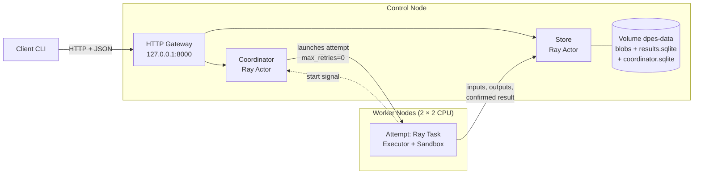

# DPES — Distributed Process Execution System
## Technical Report and User Manual

**Final Project — Distributed Systems (Computer Science, MATCOM, 4th Year)**  
**P17 — Distributed Build and Test Executor**  
**Repository:** https://github.com/sebagonz106/Distributed-Process-Execution-System  
**Branch:** \`main\`  
**Report Date:** November 18, 2026  
**Reference Commit:** \`0d309a9\` (CI green, run 44005921209)

---

# Table of Contents

1. [Introduction and System Overview](#1-introduction-and-system-overview)
2. [Architecture and Design Decisions](#2-architecture-and-design-decisions)
3. [Current Implementation Status](#3-current-implementation-status)
4. [User Manual](#4-user-manual)
5. [Future Work: Remaining Phases](#5-future-work-remaining-phases)
6. [Conclusions and Recommendations](#6-conclusions-and-recommendations)
7. [Appendices](#7-appendices)

---

# 1. Introduction and System Overview

## 1.1 Purpose and Scope

Modern Continuous Integration (CI) systems transform a code review and a declarative workflow into dozens or hundreds of executable tasks. These tasks must model dependencies, isolation, artifact management, caching, and—critically—the distinction between **task failures** (the code is wrong) and **infrastructure failures** (network, hardware, OS).

**DPES (Distributed Process Execution System)** is a service that:
- Accepts build or test jobs with commands, dependencies, inputs, outputs, and resource requirements
- Dispatches tasks to workers that execute them in isolated environments
- Returns final status, logs, and artifacts to the client

The project implements **nine functional requirements (R1–R9)** derived from the course specification, each decomposed into features with priorities M (Must), S (Should), C (Could), W (Won't).

## 1.2 The Problem Domain

Traditional CI systems (GitHub Actions, Buildkite, GitLab CI, Jenkins) share common patterns:
- **Workflows/Jobs/Steps** hierarchy with explicit dependencies (`needs`)
- **Runners/Agents/Executors** that pull work and execute in isolation (VMs, containers)
- **Artifact storage** for passing files between steps and to users
- **Log streaming** for real-time visibility
- **Retry policies** often based on exit codes or agent loss
- **Caching** keyed by user-defined strings

DPES adopts these patterns but makes **fault-modeling explicit**: every retry, every classification, every confirmation point is implemented and testable, not delegated to the middleware. This is a course requirement: "every decision is justified with the failure model and the guarantees defended."

## 1.3 Functional Requirements (R1–R9)

| ID | Requirement | Summary |
|----|-------------|---------|
| **R1** | Job reception with dependencies | Trust boundary: full validation, atomic rejection, idempotent submission |
| **R2** | DAG planning | Topological order, cycle detection with path, ready-set dispatch, resource-aware placement, failure propagation, explicit state machine |
| **R3** | Isolated execution on workers | Fresh workspace per attempt, declared-only I/O, clean environment, process-group kill on timeout, per-worker containers |
| **R4** | Input/artifact transfer | Content-addressed store (SHA-256), client upload, verified placement, declared-output collection, inter-task artifact flow, client download |
| **R5** | Log recording and streaming | Stdout/stderr capture, incremental fragments during execution, offset-based query + live tail, survival after worker death, correlated event history |
| **R6** | Failure classification | Three classes: TASK (command failed), WORKER (executor/node died), NETWORK (communication failed). Pure classifier from evidence. Final state distinguishes task vs infrastructure failure. |
| **R7** | Lost confirmation handling | Execution identity, confirmation point (durable save before reply), idempotent save (first writer wins), reconciliation before retry, late/duplicate confirmations discarded, executor retries save, coordinator recovery after restart |
| **R8** | Retry policies by failure class | TASK: 0 retries; WORKER: immediate retries; NETWORK: exponential backoff with jitter. Per-task configurable budgets. Exhausted budget → final failure preserving class. |
| **R9** | Content-based caching | Action key = hash(command, env, inputs(path→digest), declared outputs, platform). Lookup before dispatch; on hit, task succeeds without execution. Only successes cached. Chained keys via dependency output digests. |

## 1.4 Technology Stack

| Layer | Technology | Rationale |
|-------|------------|-----------|
| Language | **Python 3.13** | Course requirement; standard library sufficient for almost everything |
| Distributed Substrate | **Ray 2.60.0** | Cluster membership, resource-aware placement, transport, node failure detection. Used *only* as substrate; control plane (ordering, classification, retries, confirmation, caching) is custom code |
| Containers | **Docker 29 / Docker Compose** | Reproducible deployment; 3-node cluster (1 control + 2 workers) on isolated network |
| Persistence | **SQLite** (stdlib) | Atomic transactions for "first writer wins"; one file per owner (coordinator, store). Docker volume `dpes-data` on control node |
| Serialization | **JSON** (stdlib) | Explicit trust boundary; client needs only Python |
| Testing | **unittest** (stdlib) | Four levels: pure unit, sandbox unit (Linux), integration (local Ray), end-to-end + fault injection (Docker cluster) |
| CI/CD | **GitHub Actions** | Unit tests outside container + cluster in CI (unit as root, integration, e2e). Image publish to GHCR |
| OS | Workers: **Linux** (containers); Dev: Windows 11 + Docker Desktop | Ray limited on Windows; all Ray-dependent code runs in containers |

## 1.5 System Guarantees (Failure Model)

The system defines **four safety properties (S)** that must *never* be violated and **one liveness property (L)** that must *eventually* hold:

| Guarantee | Description | Mechanism |
|-----------|-------------|-----------|
| **S1** | A task has at most one confirmed result per round | SQLite PK `(job, task, round)` in store; `INSERT OR IGNORE` |
| **S2** | A task never starts before all dependencies have confirmed success | Pure state machine (`scheduler.Job`): only launches dependents when all `needs` are `SUCCEEDED` |
| **S3** | Delivered blob content matches its SHA-256 digest | Verification at every hop: gateway on upload, store on save, executor on placement, client on download |
| **S4** | Cached result reused only for identical action key | Action key = SHA-256 of canonical JSON (command, env, inputs path→digest, declared outputs, platform, version). Cache index written in same transaction as success confirmation |
| **L1** | Every accepted job reaches a final state | Each attempt has queue deadline (1h) and run deadline (timeout+5s). Finite retry budgets per class. Coordinator recovers state after restart (Phase 8) |

**Execution Semantics (D12.8):** The *command* executes **at least once** (may repeat if executor dies before saving). The *result* is confirmed **at most once** per round (S1). The client observes a single result. External side effects (deploy, email) may repeat; tasks with such effects set infrastructure retries to zero to get "at most once."

## 1.6 Comparison with Reference Systems

| Aspect | GitHub Actions | Buildkite | HTCondor | DPES |
|--------|----------------|-----------|----------|------|
| Unit & Dependencies | Workflow → Jobs (`needs`) → Steps | Pipeline of steps (`depends_on`) | Jobs; DAG with DAGMan | Job → Tasks (`needs`) |
| Who Initiates Execution | Runner pulls work | Agent pulls work | Matchmaking between job ads and machine ads | Coordinator launches; Ray chooses node |
| Isolation | Fresh VM per job (hosted runners) | Whatever agent operator configures | Working dir per job; optional container | Fresh process workspace per attempt, in container workers |
| Logs | Live | Live, chunked | Files returned at end | Live, numbered fragments |
| Artifacts | Explicit upload/download | Agent publishes them | Input/output file transfer | Content-addressed store |
| Caching | User-chosen key | User mounts it | Not part of model | Automatic, by input content |
| Retries | Manual | Auto rules by exit code, incl. "agent lost" | Retries & relaunch on eviction | By failure class |

Closest architectural relative not in the list: **Bazel Remote Execution** (content-addressed store + action cache). Cited as additional reference.

---

# 2. Architecture and Design Decisions

## 2.1 High-Level Component Diagram



## 2.2 Responsibility Division: Ray vs. Custom Code

| Responsibility | Ray | Custom | Notes |
|----------------|:---:|:------:|-------|
| Cluster membership & node-down notification | ✔ | | Used as *evidence*, not decision |
| Node selection with required resources | ✔ | | CPU, memory, named capabilities |
| Message & blob transport | ✔ | | Integrity verified by us via digest |
| Remote attempt execution | ✔ | | Ray task with `max_retries=0` |
| Dependency graph & ordering | | ✔ | No chaining of Ray results |
| Failure classification | | ✔ | From Ray exceptions + executor reports |
| Retries | | ✔ | Ray retries disabled |
| Confirmation & idempotency | | ✔ | Ray's automatic recomputation disabled |
| Task isolation | | ✔ | Process workspace, not container-per-task |
| Durable state, artifacts, logs | | ✔ | Ray object memory doesn't survive owner |
| Content-based caching | | ✔ | |

**Why this split (D02.1)?** Ray provides excellent cluster infrastructure but its built-in retries and recomputation hide failures. The course requires demonstrating R6–R9 with explicit mechanisms. Custom control plane makes every property testable and defensible.

## 2.3 Core Design Decisions

### D02.3 — Pure Coordinator Core Inside an Actor
The scheduling logic is a **pure state machine** (`scheduler.Job`) with no Ray, no clock, no disk: it receives *events* (job accepted, attempt finished, attempt failed with evidence, deadline expired) and returns *orders* (launch attempt, schedule retry, mark state). The Ray actor is a thin wrapper that feeds it and executes its orders.

**Why?** (1) An actor processes one message at a time → single owner of state, no locks (Lab3). (2) Core tests without cluster, deterministic, ms-scale. (3) Properties S1, S2 verified this way.

### D02.4 — Durable State in SQLite on Control Node
One SQLite file per owner (coordinator journal, store results) on a Docker volume. Blobs and logs are files.

**Why?** In-memory loses jobs on coordinator restart → R7 impossible. External service (Redis, Postgres) adds another failing participant. SQLite gives transactions = "first writer wins."

### D02.5 — Isolation via Process Workspace (Not Container-per-Task)
Fresh temp directory, clean env (only `PATH`, `LANG`, `HOME`, declared vars), own process group (SIGKILL on timeout), stdin=/dev/null, unprivileged user `100000+pid` per attempt.

**Why?** Container-per-task requires Docker socket in worker (larger attack surface) or container-in-container. Process isolation covers R3's three senses with stdlib.

### D02.7 — Content-Addressed Store on Control Node
Each blob saved as file named by its SHA-256, write-to-temp-then-rename. Ray actor serves it to gateway and executors.

**Why?** Ray object memory not durable. Shared volume only works if all nodes co-located (doesn't demonstrate R4). Custom store: writes idempotent by construction, end-to-end integrity verified, cache key comes free.

### D02.10 — Confirmation Protocol: Save Before Reply, Reconcile Before Retry

```
Coordinator          Executor              Store
   |                   |                    |
   |--- launch attempt -->|                    |
   |                   |--- fetch inputs --->|
   |                   |<-- inputs ----------|
   |                   |  run command        |
   |                   |--- put outputs ---->|
   |                   |<-- output digests --|
   |                   |--- save result ----->|  ← CONFIRMATION POINT
   |                   |<-- winner ----------|    (first writer wins)
   |<-- confirmation ----|                    |  (may be lost)
   |                   |                    |
   |--- timeout / failure                |
   |--- reconcile (query store) --------->|
   |<-- existing result ------------------|  ← ADOPTED, no re-execution
```

**Key rules (D12.1–D12.5):**
1. Executor saves **before** replying (confirmation point)
2. Save is `INSERT OR IGNORE` in transaction → always returns winner
3. Executor retries save 3× (0.5, 1, 2s) with same key
4. Coordinator **always queries store before retrying** on infrastructure failure
5. Late/duplicate confirmations ignored; other attempt's winner returned

### D09.1 — Pure Classifier: Evidence → {TASK, WORKER, NETWORK}

| Evidence Observed by Coordinator | Class |
|----------------------------------|-------|
| `TaskResult` not success (exit≠0, timeout, missing output, resource limit) | `TASK` |
| `ExecutorFailure(WORKSPACE_FAILED)` | `WORKER` |
| Other `ExecutorFailure` (input, digest, upload, save) | `NETWORK` |
| Coordinator deadline expired (queue or run) | `NETWORK` |
| Any Ray exception (`WorkerCrashedError`, `NodeDiedError`, etc.) | `WORKER` |

**Why three classes?** The course asks to distinguish "task failure" from "infrastructure failure," and within infrastructure, "worker" from "network." Coordinator cannot *observe* cause (Lab1: crash, slowness, partition look identical); only classify by evidence. `TASK` vs infra is the reliable distinction (changes decision: don't retry vs retry). `WORKER` vs `NETWORK` only changes *how* to retry; both go through reconciliation first, so system is correct even if label is wrong.

### D09.4 — Per-Attempt Deadlines with Start Signal
Ray doesn't notify about paused/incommunicado workers (D06.14); coordinator's own deadline is the only signal.

**Two deadlines per attempt:**
- **Queue deadline:** launch → start signal (1h). Prevents attempt stuck in Ray queue from expiring without running.
- **Run deadline:** start signal → timeout+5s. Sandbox kills command at timeout; silence past margin = infrastructure failure.

### D09.3 — Exponential Backoff "By Half" for NETWORK
Before NETWORK retry *n* (from 0): wait uniform in `[cap/2, cap]` where `cap = min(30, 1·2ⁿ)` seconds.

**Why?** No jitter → simultaneous retries reload failed network (Lab4). Full jitter → wait can shrink. Half-jitter → each wait ≥ previous while cap doubles (covers default 4 retries). Past 30s cap, waits in `[15,30]` may shrink—acceptable.

### D14.1 — Coordinator Recovery via Write-Ahead Journal
Coordinator state = function of calls to its state machine. Journal in `/var/lib/dpes/coordinator.sqlite`: one row per call (`accepted`, `running`, `result`, `failure`). On restart, Ray recreates actor (`max_restarts=-1`); constructor replays journal. In-flight attempts: no `running` → launch now; has `running` → reconcile, else `WORKER` with reason "coordinator restart" (consumes budget).

**Why not snapshot/pickle?** Snapshot = second state model to maintain. Pickle = binds disk format to class internals, executes code on load (D12.1 chose JSON for same reason). Journal = minimal, rebuilds with same code, deterministic (per-job RNG seeded by job_id).

---

# 3. Current Implementation Status (as of Nov 18, 2026)

## 3.1 Summary Metrics

| Metric | Value |
|--------|-------|
| Phases Completed | **6 of 9** (0, 1, 2, 3, 5, 6; 4, 7, 8 pending) |
| Requirements Met | **7 of 9** (R1, R2, R3, R4, R6, R7, R8) |
| Requirements Pending | **R5** (task log streaming — Phase 4), **R9** (caching — Phase 7) |
| Python Code | 15 modules, ~1,800 lines |
| Total Tests | **243** (197 unit in container, 17 integration, 22 e2e, 7 host) |
| CI Status | Green on GitHub (run 44005921209) |
| Schedule Advance | 6 phases planned Nov 16–27 → closed Nov 15–16 |

## 3.2 Requirement Traceability

| Req | Status | Phases | Cut Demonstrating | CI Evidence |
|-----|--------|--------|-------------------|-------------|
| R1 | ✅ | 1, 2 | C2 | 43736551521 |
| R2 | ✅ | 2 | C2 | 43736551521 |
| R3 | ✅ | 1, 3 | C1, C3 | 43732301774; 43791223473 |
| R4 | ✅ | 3 | C3 | 43791223473 |
| R5 | 🟡 Partial | 1, 4 | — (Phase 4 pending) | — |
| R6 | ✅ | 5 | C5 | 43740571857 |
| R7 | ✅ | 6, 8 (F7.7) | C6, C8 (part) | 43807400756; 44005921209 |
| R8 | ✅ | 5 | C5 | 43740571857 |
| R9 | ⬜ | 7 | — (Phase 7 pending) | — |

**Note on R5:** Currently captures last 64 KiB of output in result (`output_tail`, D07.14) and emits system operational logs (plan/10). **Missing:** live streaming of task stdout/stderr (numbered fragments, offset query, `logs -f`, survival after worker death). That is Phase 4.

## 3.3 Completed Phases Detail

### Phase 0 — Foundations & Ray Experiment (Closed Nov 15)
Package `dpes`, contracts in `messages.py`, Docker image, compose (1 head + 2 workers), CI (unit + build), **Ray failure experiment**. Key finding (D06.14): Ray **does not notify** about paused/incommunicado workers; coordinator's own deadline is the only signal.

### Phase 1 — Single Task End-to-End (Closed Nov 15)
`spec.py` (single task), `scheduler.py` (minimal states), `gateway.py` (POST/GET), `cli.py` (submit/status/wait), `coordinator.py` (async actor pinned to head), `sandbox.py` (isolation), `executor.py` (Ray task + output capture). Key decisions: validation rejects unknown fields + returns all errors (D07.2); states `PENDING`→`RUNNING`→`SUCCEEDED/FAILED/ERROR` (D07.4); deterministic execution ID `<job>/<task>/<round>/<attempt>` (D07.5); unknown/duplicate events ignored (D07.6); async coordinator with injected executor (D07.7); state in memory until Phase 8 (D07.8); gateway `http.server` no Ray (D07.9); CLI distinct exit codes per final state (D07.10); `PYTHONPATH=/app` in image (D07.11); executor contract returns `TaskResult` or `ExecutorFailure` (D07.12); `output_tail` 64 KiB (D07.14); sandbox: fresh dir, clean env, process group, unprivileged user (D07.15–D07.16); executor knows no Ray (D07.17); gateway only on 127.0.0.1 (D07.18); `init: true` in containers (D07.19).

### Phase 2 — DAG & Resources (Closed Nov 15)
`needs`, `resources`, `dag.py`, ready-set dispatch, dependent omission, unschedulable rejection. Decisions: `needs` list + `resources` (cpu, memory_mb, named capabilities) (D08.1); cycle detection names cycle path (D08.2); resource translation to Ray + reject if no live node satisfies (D08.3); ready-set dispatch; `READY` not adopted (D08.4); failure skips transitive dependents → `SKIPPED` (D08.5); in-flight limit (F2.6, S) deferred (D08.6); `dag.py` independent of `spec.py` (D08.7); parallelism evidence from task timestamps (D08.8); state machine advances via dependents, not full scan (D08.9).

### Phase 3 — Inputs & Artifacts (Closed Nov 15, Person B)
`hashing.py`, `cas.py`, `BlobStore` actor on control node (volume `dpes-data`), `inputs`/`outputs` per task, inter-dep artifacts, `PUT`/`GET /blobs`, `artifacts` CLI. Decisions: `inputs` list → client converts to path→digest map; `outputs` list of paths (D11.1); relative, canonical, no `..` paths (D11.2); dependency outputs auto-placed (D11.3); `sha256:<hex>` verified at every hop (D11.4); disk store behind actor (D11.5); only declared outputs, never via symlink (D11.6); entire workspace owned by attempt user (D11.7); manifest in job view, CLI `artifacts` downloads (D11.8); incremental upload (F4.7, S) and OS limits (F3.6, S) not done (D11.9); permissions not transferred (D11.10); killed attempt leaves workspace (D11.11).

### Phase 5 — Failure Classification & Retries (Closed Nov 15, advanced)
`failures.py` (classifier + waits), per-task `retries`, `RETRY_WAIT`, attempt history in view, queue/run deadlines, injectable faults (`DPES_FAULT`). Decisions: pure classifier table (D09.1); policy per class (D09.2): TASK 0, WORKER 3 immediate, NETWORK 4 exp-backoff-half-jitter (D09.3); per-class budgets configurable per task; queue deadline 1h + run deadline timeout+5s with start signal (D09.4); `RETRY_WAIT` observable (D09.5); attempt history in view (D09.6); injectable faults from inside with `DPES_FAULT_INJECTION=1` (D09.7); closes D07.13 (D09.8); avoid-suspect-node (F8.4, C) not done (D09.9); deadline expiry signaled via private exception, not confused with executor return (D09.10).

### Phase 6 — Lost Confirmation (Closed Nov 16, Person A)
`store.py` (SQLite results + coordinator journal), confirmation point in executor, reconciliation in coordinator, injectable `lose-ack`, `Idempotency-Key`. Decisions: results in SQLite PK `(job, task, round)`, `INSERT OR IGNORE` → first writer wins (D12.1); executor saves before reply, including command failures (D12.2); executor retries save 3× same key (D12.3); coordinator reconciles before retry (D12.4); state machine resolves attempt with foreign result (adopted or winner) (D12.5); `lose-ack` = executor saves then dies without reply (D12.6); `Idempotency-Key` on `POST /jobs`, client retries 3× (D12.7); guarantees S1 via PK; command at-least-once, result at-most-once (D12.8).

### Phase 8 Part A — Coordinator Recovery (Closed Nov 16, Person A)
Journal in SQLite `/var/lib/dpes/coordinator.sqlite` (D14.1); write journal before effect (D14.2); Ray restarts actor, constructor replays (D14.3); in-flight handling (D14.4); client treats 503 as no answer (D14.5); guarantees L1 holds across restart; idempotency keys survive (D14.6).

## 3.4 Module Map (15 modules, ~1,800 lines)

| Module | Lines | Role | Pure (no Ray/disk/clock) | Track |
|--------|------:|------|:------------------------:|:-----:|
| `messages.py` | 87 | Contracts between components (frozen Phase 1) | ✔ | A |
| `spec.py` | 273 | Job format, validation, resources | ✔ | A |
| `dag.py` | 35 | Iterative cycle detection | ✔ | A |
| `failures.py` | 54 | Classifier & retry waits | ✔ | A |
| `scheduler.py` | 239 | Job state machine | ✔ | A |
| `hashing.py` | 15 | SHA-256 digests | ✔ | B |
| `coordinator.py` | 359 | Coordinator & Store actors, deadlines, reconciliation | | A |
| `gateway.py` | 152 | HTTP API & trust boundary | | A |
| `cli.py` | 153 | Client: submit, status, wait, artifacts | | A |
| `executor.py` | 166 | One attempt: inputs, command, outputs, confirmation | | B |
| `sandbox.py` | 79 | Command isolation | | B |
| `cas.py` | 52 | Blobs on disk, atomic write | | B |
| `store.py` | 150 | SQLite confirmed results + coordinator journal | | A |
| `log.py` | 56 | Operational log format & config | | A |

Six pure modules test on Windows without cluster. HTTP API: `POST /jobs` (optional `Idempotency-Key`), `GET /jobs/{id}`, `PUT`/`GET /blobs/{digest}`.

## 3.5 Job Execution Flow (Current)

1. Client uploads inputs by digest, submits job with idempotency key; retries with same key if no answer.
2. Gateway validates structure, deps, cycles, paths; adapter rejects what no live node can run or refs missing blobs. All rejections = `400` with all errors.
3. Coordinator creates job, launches root tasks with resources translated to Ray.
4. On worker: wrapper signals start (run deadline begins), executor places & verifies inputs, runs command in sandbox, uploads declared outputs, **saves result before replying**. Returns winner.
5. Coordinator receives result or failure. On failure without result, queries store first; if result saved, adopts it. Else classifies & retries within class budget or terminates task, skipping dependents.
6. Job ends `SUCCEEDED`, `FAILED` (task failed), or `ERROR` (infra failed); `wait` exits 0/1/2. Client downloads artifacts verifying digests.

## 3.6 Verification & Quality

| Level | Tests | Coverage | Execution |
|-------|-------|----------|-----------|
| **Pure Unit** | 159 (Win) / 197 (container root) | spec, dag, failures, scheduler, hashing, messages, store, gateway, log | `py -m unittest discover -s tests/unit` (Win); Docker (Linux) |
| **Sandbox/Executor Unit** | 38 (Linux only) | sandbox, executor | Docker (need Linux: process groups, root user) |
| **Integration** | 17 | Coordinator + test executor + store on local Ray | `docker compose exec -T head python -m unittest discover -s tests/integration` |
| **End-to-End (Cuts)** | 22 | C0, C1, C2, C3, C5, C6, C8(part) via real gateway | `docker compose exec -T head python -m unittest discover -s tests/e2e` |
| **Host (Real Docker)** | 7 | Real worker kill, log trace of job | `py -m unittest discover -s tests/host` |

**Real bugs caught by tests before delivery:**
- Lost exception in actor background task left jobs `RUNNING` forever (D07.12)
- Exponential backoff growth guarantee only held until 30s cap (D09.3)
- Deadline expiry confused with executor return value (D09.10)
- Gateway logger discarded when started via `python -m` (D10.8)
- Race reading `/proc` made sandbox test flaky (plan/07 §3)

---

# 4. User Manual

## 4.1 Prerequisites

- **Docker Desktop 29+** installed and running
- **Python 3.13** (`py` launcher on Windows, `python3` on Linux/macOS)
- **Git** (optional, for cloning)

## 4.2 Quick Start

```bash
# Clone and enter
git clone https://github.com/sebagonz106/Distributed-Process-Execution-System
cd Distributed-Process-Execution-System

# Start cluster (builds image, starts 3 containers)
docker compose -f docker/compose.yaml up -d --build
# Wait ~30s for head healthcheck to pass

# Submit the demo job (compiles a small C program)
py -m dpes.cli submit examples/hola/job.json
# → prints job_id (e.g., a1b2c3d4)

# Wait for completion (blocks until done)
py -m dpes.cli wait <job_id>
# Exit codes: 0=SUCCEEDED, 1=FAILED, 2=ERROR

# Download artifacts (verifies digests)
py -m dpes.cli artifacts <job_id> link <destination_folder>

# Shutdown (volume dpes-data persists)
docker compose -f docker/compose.yaml down
```

## 4.3 Job Specification Format (`job.json`)

```json
{
  "tasks": {
    "compile-main": {
      "command": ["gcc", "-c", "main.c", "-o", "main.o"],
      "inputs": ["main.c", "greet.h"],
      "outputs": ["main.o"],
      "resources": {"cpu": 1},
      "timeout_s": 60,
      "retries": {"task": 0, "worker": 3, "network": 4}
    },
    "link": {
      "command": ["gcc", "main.o", "greet.o", "-o", "hola"],
      "needs": ["compile-main", "compile-greet"],
      "outputs": ["hola"]
    },
    "test": {
      "command": ["sh", "-c", "chmod +x hola && ./hola | grep -x 'hola, mundo'"],
      "needs": ["link"]
    }
  }
}
```

### Field Reference

| Field | Level | Required | Description |
|-------|-------|----------|-------------|
| `tasks` | Job | Yes | Map `task_name` → task spec |
| `command` | Task | Yes | Non-empty list of strings (argv). First element = program. Use `["sh","-c","..."]` for shell. |
| `env` | Task | No | Map `VAR` → `string`. Default `{}`. |
| `timeout_s` | Task | No | Seconds >0, ≤86400. Default 600. |
| `needs` | Task | No | List of task names in same job. No cycles. Default `[]`. |
| `resources` | Task | No | Map: `cpu` (float>0), `memory_mb` (int>0), custom capabilities (e.g., `"gcc": 1`). Default `{"cpu": 1}`. |
| `retries` | Task | No | Per-class budgets: `task`, `worker`, `network` (int 0–10). Defaults: 0, 3, 4. |
| `inputs` | Task | No | Map `relative_path` → `sha256:<hex>`. Client computes from local files. |
| `outputs` | Task | No | List of relative paths produced inside workspace. |
| `cache` | Task | No | `false` to disable caching for this task (Phase 7). Default `true`. |

**Path Rules:** Relative, canonical (no `..`, no `\\`, no duplicate slashes), ≤255 chars. Client uploads local files → computes digests → sends map.

## 4.4 CLI Commands

```bash
# Submit job (uploads inputs, sends spec)
py -m dpes.cli submit <job_file> [--url <gateway_url>]
# → prints job_id

# Get full job status (JSON)
py -m dpes.cli status <job_id> [--url <url>]

# Wait for job completion (polls every 1s)
py -m dpes.cli wait <job_id> [--interval <sec>] [--url <url>]
# Exit codes: 0=SUCCEEDED, 1=FAILED, 2=ERROR, 3=request failed

# Download artifacts of a task (verifies each digest)
py -m dpes.cli artifacts <job_id> <task_name> <destination_folder> [--url <url>]

# Task logs (after Phase 4 implementation)
py -m dpes.cli logs <job_id> <task_name> [-f] [-o <offset>] [--url <url>]
```

### Environment Variables

| Variable | Default | Purpose |
|----------|---------|---------|
| `DPES_URL` | `http://localhost:8000` | Gateway base URL for CLI |
| `DPES_LOG_LEVEL` | `INFO` | Log level for system components (`DEBUG`, `INFO`, `WARNING`, `ERROR`) |
| `DPES_FAULT_INJECTION` | (unset) | Set to `1` on workers to enable fault injection (test cluster only) |

## 4.5 HTTP API (Gateway)

Base URL: `http://127.0.0.1:8000` (only published port)

| Verb & Path | Purpose | Success | Errors |
|-------------|---------|---------|--------|
| `POST /jobs` | Submit job | `201 {job_id}` | `400 {errors[]}`, `413`, `503` |
| `GET /jobs/{id}` | Job + task status | `200 {view}` | `404`, `503` |
| `PUT /blobs/{digest}` | Upload blob | `201 {digest}` | `400`, `411`, `413`, `503` |
| `GET /blobs/{digest}` | Download blob | `200 application/octet-stream` | `404`, `503` |
| `GET /jobs/{id}/tasks/{task}/logs?offset={n}` | Task log from offset (Phase 4) | `200 text/plain` | `404`, `503` |
| `GET /jobs/{id}/events` | Job event history (Phase 4) | `200 [{event}]` | `404`, `503` |

**Idempotent Submission:** Include header `Idempotency-Key: <1-64 [A-Za-z0-9_-]>`. Same key + same job → same `job_id`. Same key + different job → `400`. Client auto-generates key and retries 3× on no answer.

**Blob Integrity:** Every `PUT`/`GET` verifies content matches digest. Mismatch → `400`.

## 4.6 Understanding Job Status

```json
{
  "job_id": "a1b2c3d4",
  "state": "SUCCEEDED",
  "tasks": {
    "compile-main": {
      "state": "SUCCEEDED",
      "needs": [],
      "execution_id": "a1b2c3d4/compile-main/0/1",
      "exit_code": 0,
      "timed_out": false,
      "output": "...last 64 KiB...",
      "outputs": {"main.o": "sha256:abc123..."},
      "failure_class": null,
      "error": null,
      "attempts": [
        {"execution_id": "...", "outcome": "SUCCEEDED", "reason": "", "retry_in_s": null}
      ]
    }
  }
}
```

### Task States

| State | Meaning |
|-------|---------|
| `PENDING` | Waiting for dependencies |
| `RUNNING` | Attempt in flight (may be queued in Ray) |
| `RETRY_WAIT` | Failed with budget left; waiting before retry |
| `SUCCEEDED` | Command exited 0, all outputs produced |
| `FAILED` | Command failed (exit≠0, timeout, missing output); no task retries left |
| `ERROR` | Infrastructure failure (worker/network); no infra retries left |
| `SKIPPED` | Dependency did not succeed |

### Final Job States

| State | Meaning | CLI Exit |
|-------|---------|----------|
| `SUCCEEDED` | All tasks `SUCCEEDED` | 0 |
| `FAILED` | At least one `FAILED` | 1 |
| `ERROR` | No `FAILED`, but at least one `ERROR` | 2 |

## 4.7 Logs & Debugging

### System Operational Logs (Control Node)
```bash
# Full trace of a job (correlated by job_id)
docker logs dpes-head 2>&1 | grep <job_id>

# Single attempt
docker logs dpes-head 2>&1 | grep <job_id>/<task>/<round>/<attempt>
```

Log format (per plan/10):
```
2026-11-15T21:04:05.123Z INFO    coordinator attempt launched execution=a1b2.../compile-main/0/1 cpu=1.0
2026-11-15T21:04:05.310Z INFO    executor    command finished execution=a1b2.../compile-main/0/1 exit_code=0 timed_out=False duration_s=0.18
```
Every line carries `execution=<id>` (contains job/task/round/attempt) or `job=<id>`. Pure modules (`spec`, `dag`, `failures`, `scheduler`, `messages`) never log. Never logs env vars or command output.

### Task Logs (Phase 4 — after implementation)
```bash
# Live tail
py -m dpes.cli logs <job_id> <task> -f

# From offset
py -m dpes.cli logs <job_id> <task> -o 1000

# Or via HTTP
curl "http://localhost:8000/jobs/<job_id>/tasks/<task>/logs?offset=0"
```

### Event History (Phase 4)
```bash
curl http://localhost:8000/jobs/<job_id>/events
```
Returns chronological events: job accepted, task launched, attempt succeeded/failed, class, retry scheduled, job finished.

## 4.8 Fault Injection (Test Cluster Only)

Enable on workers via compose (`DPES_FAULT_INJECTION=1`). Then in task spec:

```json
{
  "tasks": {
    "flaky": {
      "command": ["make", "test"],
      "env": {"DPES_FAULT": "crash:2"},
      ...
    }
  }
}
```

| Fault Kind | Effect | Coordinator Sees | Class |
|------------|--------|------------------|-------|
| `crash:N` | Executor process exits (first N attempts) | `WorkerCrashedError` | `WORKER` |
| `network:N` | Executor returns `INPUT_UNAVAILABLE` (first N) | `ExecutorFailure` | `NETWORK` |
| `hang:N` | Executor sleeps forever (first N) | Deadline expiry | `NETWORK` |
| `lose-ack:N` | Executor saves result then exits (first N) | No reply → reconcile | `WORKER` |

## 4.9 Common Issues & Troubleshooting

| Symptom | Likely Cause | Action |
|---------|--------------|--------|
| `wait` exits code 3 | Gateway unreachable or 503 | Check `docker compose ps`, `docker logs dpes-head` |
| Job stuck `RUNNING` | Worker dead, no deadline (pre-Phase 5) | Upgrade to current version; Phase 5 adds deadlines |
| `400` on submit | Validation error (cycle, missing blob, bad path) | Read `errors[]` in response; fix job.json |
| Artifact digest mismatch | Corrupted transfer or stale cache | Re-upload inputs; re-run job |
| `logs -f` shows nothing | Phase 4 not implemented yet | Implement Phase 4; currently only `output_tail` in status |
| Coordinator restart loses jobs | Pre-Phase 8 version | Current version recovers via journal (F7.7) |

---

# 5. Future Work: Remaining Phases

## 5.1 Phase 4 — Live Logs & Event History (R5)

### 5.1.1 Why It's Needed
R5 requires **recording and streaming** of task logs: capture stdout/stderr, incremental emission **during execution**, offset-based query + live `logs -f`, survival after worker death. Current `output_tail` (64 KiB in result) and system logs are insufficient for production debugging.

### 5.1.2 Components to Implement

| Component | File(s) | Description |
|-----------|---------|-------------|
| **Log Store** | `dpes/logstore.py` (new), `LogStore` actor on control node | Persists numbered fragments per attempt on volume `dpes-data`. Idempotent write by sequence number. |
| **Executor Emission** | `dpes/executor.py` (modify) | Capture stdout/stderr (already to file, D07.15), send fragments to `LogStore` every N lines/bytes or T seconds. |
| **Gateway API** | `dpes/gateway.py` (modify) | `GET /jobs/{id}/tasks/{task}/logs?offset={n}&limit={m}` + chunked transfer for `logs -f`. |
| **CLI** | `dpes/cli.py` (modify) | `logs <job> <task> [-f] [-o offset]`. |
| **Event History** | `dpes/scheduler.py` (extend), `dpes/coordinator.py` | Every state transition, attempt, failure class, retry decision → event with `execution=` or `job=`. Served by `GET /jobs/{id}/events`. |

### 5.1.3 Key Implementation Details
- **Numbered fragments (D02.8):** Executor sends `(seq, bytes)`; `LogStore` appends, ignores duplicates (idempotent by seq). Client requests "from offset n", retries on gaps.
- **Worker death survival:** Fragments already reached `LogStore` on control node (persistent volume). Worker death doesn't delete received data.
- **Pure modules don't log (D10.4):** `spec`, `dag`, `failures`, `scheduler`, `messages` emit nothing. Wrapping layers (coordinator, executor, gateway) log via `dpes.log.event(logger, level, msg, **fields)` always with `execution=` or `job=`.
- **Never log env or command output (D10.6):** Only `argv[0]` and arg count.
- **Ray deduplicates logs (D10.7):** Disable with `RAY_DEDUP_LOGS=0` on control node; execution IDs contain numbers Ray treats as identical.

### 5.1.4 Completion Criteria (Cut C4)
1. `logs -f` shows lines of a long-running task **while it runs** (true streaming).
2. After **killing its worker mid-execution**, emitted logs remain queryable by offset.
3. `events` shows job history with execution IDs, transitions, failure classes, retry waits.
4. Unit tests: duplicate fragment ignored, offset read, causal order.
5. E2E test `tests/e2e/test_logs.py` passes in CI (cut C4).
6. Documented in `plan/NN-fase-4-logs.md` with decisions `DNN.k`.

### 5.1.5 Risks
- Ray log deduplication may merge distinct attempts → must disable.
- Chunked HTTP streaming + offset queries need careful buffering.
- Log volume growth → consider rotation/retention (out of scope).

---

## 5.2 Phase 7 — Content-Based Caching (R9)

### 5.2.1 Why It's Needed
R9 avoids re-executing identical work when inputs haven't changed. Fundamental optimization for distributed build/test: turns full rebuilds into incremental. Correctness depends on isolation (R3) and content transfer (R4). Without R9, system is functional but inefficient for its primary use case.

### 5.2.2 Components to Implement

| Component | File(s) | Description |
|-----------|---------|-------------|
| **Action Key** | `dpes/hashing.py` (extend) | `action_key(spec, task_name, dep_outputs)` → SHA-256 of canonical JSON: command, declared env, inputs (path→digest **including deps**), declared outputs, platform, format version. |
| **Cache Index** | `dpes/store.py` (extend `ResultLog`) | Table `cache`: `action_key → (job, task, round)` of success. Written in **same transaction** as result confirmation (D02.12). |
| **Pre-Dispatch Lookup** | `dpes/scheduler.py` (extend `Job._launch`) | Before first attempt, compute key, query cache. On hit: task → `SUCCEEDED` with cached artifacts; no attempt launched. |
| **Per-Task Opt-Out** | `dpes/spec.py` (extend `TaskSpec`) | Optional `cache: false` (S, F9.5) for non-deterministic tasks (e.g., timestamp tests). |
| **In-Flight Deduplication (C)** | `dpes/scheduler.py` (optional) | If two tasks (same or concurrent jobs) share action key and one is running, second waits in `RETRY_WAIT` with delay 0 until first finishes. |

### 5.2.3 Key Implementation Details
- **Chained keys (F9.4, D02.12):** Task key includes dependency output digests. Change that doesn't alter artifact (e.g., comment in `.c`) recompiles that file but **does not** invalidate dependents (linker sees same `.o`).
- **Only successes cached (F9.3):** Index written only on `SUCCEEDED` confirmation.
- **Platform in key (D02.12):** Worker image identifier (e.g., `dpes:dev@sha256:...`) prevents serving binary built with different compiler.
- **Cache hit log (F5.6, S):** On hit, attempt history shows `outcome: CACHE_HIT`; client can fetch original execution's log (requires Phase 4).

### 5.2.4 Completion Criteria (Cut C7)
1. Re-submitting demo job **unchanged** executes **zero tasks**; artifacts download identically.
2. Changing `main.c` executes **only its compile** and transitive dependents (`link`, `test`).
3. Change producing same object (comment in `greet.c`) recompiles that file but **does not re-link** (chained key).
4. Pure unit tests of key: what changes it and what doesn't (D02.12).
5. E2E test `tests/e2e/test_cache.py` passes in CI (cut C7).
6. Documented in `plan/NN-fase-7-cache.md` with decisions `DNN.k`.

### 5.2.5 Risks
- Cache key collision (SHA-256) negligible but document assumption.
- Cache index growth → no eviction policy in scope (document as limit).
- Requires Phase 4 for `CACHE_HIT` log serving.

---

## 5.3 Phase 8 — Hardening & Delivery (Remaining Parts)

### 5.3.1 Pending Items

| Task | Owner | Description | Done When |
|------|-------|-------------|-----------|
| **T3: Image Publish** | B | GH Actions `release.yml`: on version tag, `docker push` to GHCR with `latest` + `vX.Y.Z` | Image public at `ghcr.io/sebagonz106/distributed-process-execution-system` |
| **T5: Architectural Comparison** | A | Doc `plan/NN-comparison.md`: full table vs GitHub Actions, Buildkite, HTCondor, Bazel RBE. Verified sources (official docs, papers). Cited in final report. | Doc approved; table in `plan/02` §5 updated |
| **T6: Clean Clone Demo** | B | Script `demo.sh`: `git clone`, `docker compose up -d --build`, `cli submit`, `wait`, `artifacts`, run binary. Tested on clean VM/CI. | Script works on clean machine; documented in README |
| **Diagrams Current** | A | Regenerate 7 `.mmd` → `.svg` (plan/05, D05.1): phase deps, module deps, job flow, coordinator decision, executor flow, task states, lost ack. | `.svg` match `.mmd` and reflect current code (include `store`, `cas`, `failures`, `hashing`, `log`) |
| **Plan Review** | A | Verify `plan/00` traceability complete, decisions gapless, risks updated. | `plan/00` R1–R9 table current |
| **Version Tag** | A/B | `git tag v1.0.0 && git push --tags` after freeze (Nov 29) | Tag on GitHub, CI green |
| **User Guide** | B | `docs/usage.md` or README section: install, submit, query, artifacts, logs, faults, cache. | Readable by newcomer |

### 5.3.2 Completion Criteria (Cut C8)
1. From **clean clone**, single command (`demo.sh` or `make demo`) starts cluster and runs **all cuts C1–C7**.
2. **Image published** on GHCR, version tagged in Git.
3. **Coordinator restart** mid-job doesn't prevent completion (verified in C8 part F7.7).
3. **Architectural comparison** delivered with verified sources.
4. **Diagrams** regenerated and matching implementation.
5. **CI green** on final tag.
6. **README & user guide** complete.

---

## 5.4 Adjusted Schedule (from current state)

| Date | Activity | Owner | Notes |
|------|----------|-------|-------|
| **Nov 19–20** | Phase 4: LogStore, executor emission, gateway API, CLI logs, events | B | Data track; needs sandbox/executor ready |
| **Nov 21–22** | Phase 4: Unit, integration, e2e tests (C4). **Control Point 1 (Nov 22): C0–C3 + C4** | B | If C4 not closed → cut S features (D03.6) |
| **Nov 23–24** | Phase 7: Action key, cache index, scheduler lookup, `cache: false` | B | Uses `store.py` (has `ResultLog`), `hashing.py` |
| **Nov 25–26** | Phase 7: Pure unit tests, e2e (C7). **Control Point 2 (Nov 26): C4, C5, C7** | B | If C7 not closed → cut S |
| **Nov 27–28** | Phase 8 (B): Image publish (T3), demo (T6), user guide | B | Parallel with A on T5, diagrams |
| **Nov 27–28** | Phase 8 (A): Architectural comparison (T5), diagrams, plan review, tag | A | T5 is course deliverable; needs documented research |
| **Nov 29** | **Code Freeze** (D04.6). Only bug fixes from rehearsal. | A+B | |
| **Nov 30** | Full demo rehearsal; final fixes | A+B | |
| **Dec 1** | **Delivery** | A+B | |

---

# 6. Conclusions and Recommendations

## 6.1 What Works Well

- **Clear track separation (control vs data)** enabled parallel development with minimal conflicts (D04.1).
- **Pure coordinator core (`scheduler.Job`)** makes the hardest logic (DAG, failures, retries, confirmation) testable deterministically in ms without cluster (D02.3).
- **Frozen contracts in `messages.py`** (Phase 1) stabilized integration.
- **Ray failure experiment (Phase 0)** prevented wrong assumptions about what Ray reveals (D06.14).
- **Idempotent save + reconciliation** solves R7 elegantly without distributed locks (D02.10, D12.1–D12.4).
- **Pure classifier** decouples failure taxonomy from Ray, enables exhaustive testing (D09.1).
- **Coordinator write-ahead journal** makes recovery a deterministic replay (D14.1).

## 6.2 Known Limits & Technical Debt

| Limit | Impact | How to Lift |
|-------|--------|-------------|
| Single point of failure (control node) | Availability, not durability | Coordinator replicas with leader election (Raft) + replicated state |
| Incomplete isolation | Task can read worker FS/net, escape via `setsid` | User/process/network namespaces (F3.7) or per-task container (gVisor/Kata) |
| No authentication | Trusted networks only | Mutual TLS + tokens in gateway; `DPES_FAULT_INJECTION` only in test cluster |
| Blobs fully in memory (16 MiB) | Artifact size limit | Chunked upload/download |
| Coordinator journal uncompacted | Linear growth with jobs | Periodic checkpoint of finished jobs |
| No store/cache TTL/GC | Disk grows indefinitely | TTL policy + periodic GC; LRU for cache |
| 3 containers on 1 machine ≠ 3 machines | Fast container death detection ≠ power loss | Multi-machine cluster experiments; document limit (D06.13) |

## 6.3 Recommendations for Continuation

1. **Absolute priority: Phase 4 (logs) and Phase 7 (cache).** Only two missing functional requirements (R5, R9). Track B (Person B) unblocked; Track A can support reviews/tests.
2. **Start architectural comparison (T5) now.** Requires reading GitHub Actions, Buildkite, HTCondor, Bazel RBE official docs. Course deliverable; takes writing time.
3. **Configure image publish (T3) in GH Actions this week.** Pure CI/CD infra, no new code dependency.
4. **Regenerate diagrams as soon as Phases 4/7 close.** Module diagram (plan/05) already stale (missing `log.py`, shows `store`/`cas`/`failures`/`hashing` as "planned").
5. **Keep "no branches, push direct to main" (D04.8).** Review diff locally before push; CI catches regressions.
6. **Document every decision in `plan/` before coding.** The `context → options → decision → why → consequences` format forces thinking and leaves defense trail.

---

# 7. Appendices

## 7.1 Repository Structure (Reference)

```
Distributed-Process-Execution-System/
├── dpes/                    # Main package
│   ├── __init__.py
│   ├── messages.py          # Contracts (frozen Phase 1)
│   ├── spec.py              # Job format & validation
│   ├── dag.py               # Cycle detection
│   ├── failures.py          # Classifier & retry waits
│   ├── scheduler.py         # Pure job state machine
│   ├── hashing.py           # SHA-256, canonical JSON
│   ├── coordinator.py       # Coordinator + Store actors
│   ├── gateway.py           # HTTP API
│   ├── cli.py               # CLI client
│   ├── executor.py          # One attempt (no Ray)
│   ├── sandbox.py           # Command isolation
│   ├── cas.py               # Blobs on disk
│   ├── store.py             # SQLite: results + journal
│   └── log.py               # Operational log format
├── tests/
│   ├── unit/                # 197 pure + Linux tests
│   ├── integration/         # 17 with local Ray
│   ├── e2e/                 # 22 cut scripts C0–C8
│   └── host/                # 7 real Docker tests (worker kill, log trace)
├── examples/
│   └── hola/                # Demo: 4 C tasks (compile×2, link, test)
├── docker/
│   ├── Dockerfile           # python:3.12-slim + gcc + make + ray
│   └── compose.yaml         # head (0 CPU) + worker-1,2 (2 CPU each)
├── plan/                    # 15 decision docs (00–14)
│   └── diagramas/           # 7 .mmd + .svg pairs
├── experiments/             # Ray failure experiment (Phase 0)
├── .github/workflows/ci.yml # CI: unit → build → integration → e2e + host
├── PROGRESO.md              # Phase board with icons/bars/dates
├── CLAUDE.md                # Project mandatory rules
└── README.md                # (To complete in Phase 8)
```

## 7.2 Key Decision References

| Decision | Document | Summary |
|----------|----------|---------|
| D02.1 | plan/02 | Ray as substrate, custom control plane |
| D02.3 | plan/02 | Pure coordinator core in `scheduler.Job` |
| D02.4 | plan/02 | Durable state in SQLite per owner |
| D02.5 | plan/02 | Process workspace isolation |
| D02.7 | plan/02 | Content-addressed store on control node |
| D02.10 | plan/02 | Save before reply, reconcile before retry |
| D09.1 | plan/09 | Pure classifier: evidence → 3 classes |
| D09.4 | plan/09 | Per-attempt queue/run deadlines with start signal |
| D12.1 | plan/12 | SQLite results, first writer wins |
| D14.1 | plan/14 | Coordinator journal = write-ahead log |

## 7.3 Glossary

| Term | Definition |
|------|------------|
| **Job** | Client submission: map of tasks with dependencies, inputs, outputs, resources |
| **Task** | Unit of work within a job; has command, deps, I/O, resources, retry policy |
| **Attempt** | One execution of a task on a worker; identified by `<job>/<task>/<round>/<attempt>` |
| **Round** | Increments only on intentional `TASK` retry; infra retries share round |
| **Confirmation Point** | Moment executor durably saves result in store *before* replying to coordinator |
| **Reconciliation** | Coordinator queries store for result before retrying on infrastructure failure |
| **Action Key** | SHA-256 of canonical JSON (command, env, inputs path→digest, declared outputs, platform) — cache lookup key |
| **Chained Key** | Action key includes dependency output digests; unchanged artifact doesn't invalidate dependents |
| **Idempotency Key** | Client-provided header on `POST /jobs` to make submission safe to retry |
| **Pure Module** | No Ray, no disk, no clock; testable on Windows without cluster |