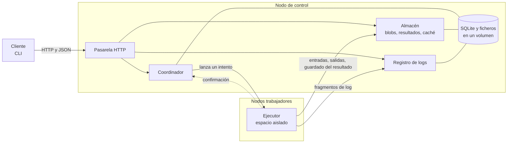
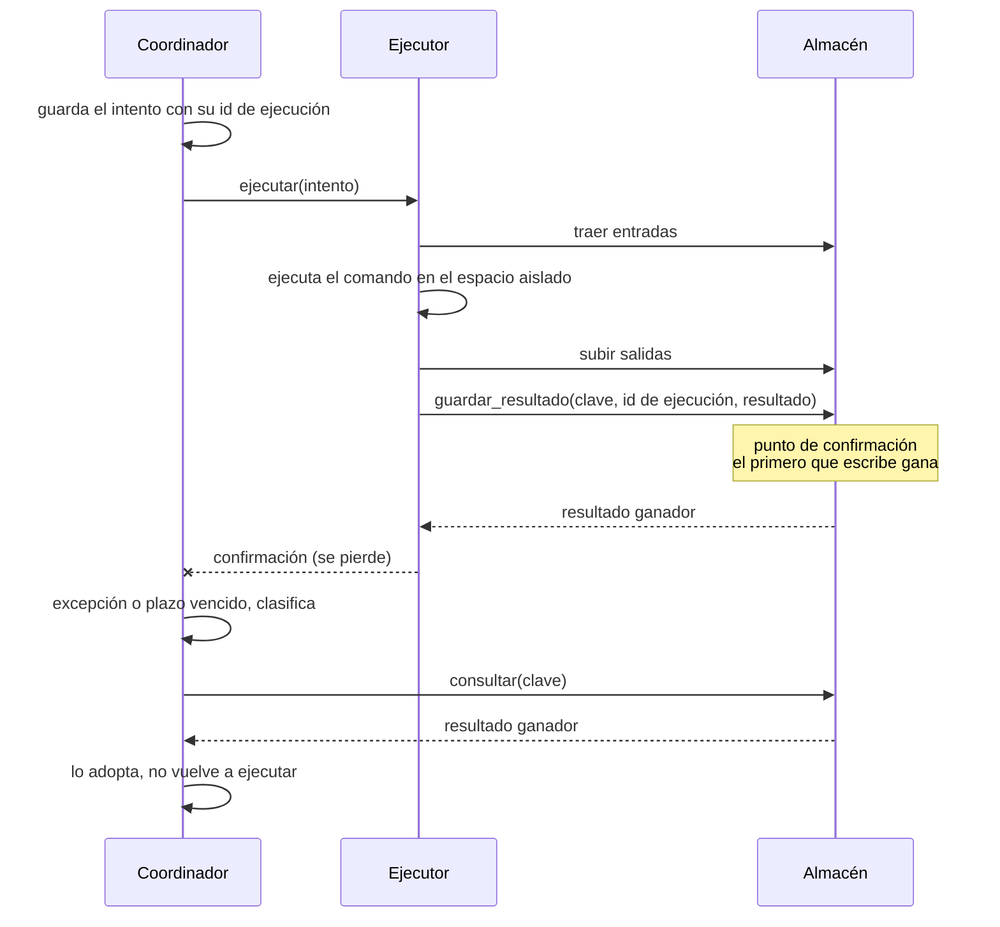

# 02 — Arquitectura

- **Fecha:** 2026-11-14
- **Estado:** aprobado el 2026-11-14
- **Paso:** diseño previo a la implementación
- **Resuelve:** las decisiones abiertas A1–A10 de
  [00-contexto-y-restricciones.md](00-contexto-y-restricciones.md)

Los nombres exactos de las excepciones y los tiempos de detección de Ray que
aparecen aquí son **hipótesis** hasta que el experimento de la Fase 0 los
confirme (03, Fase 0). Verificado el 2026-11-14: Ray 2.60.0, Python ≥ 3.10, y
que una tarea de Ray se reintenta 3 veces por defecto salvo `max_retries=0`.

## 1. Modelo del sistema

Antes de elegir técnicas, se describe el sistema (Lab1): quién participa, qué
fallos se aceptan y qué se promete.

**Participantes.** Clientes, un nodo de control y varios nodos trabajadores.
Cada uno tiene su memoria y falla por su cuenta; lo que uno sabe de otro es lo
último que le llegó en un mensaje.

**Fallos que se toleran.**

| Participante | Modelo | Consecuencia |
|--------------|--------|--------------|
| Trabajador | Se cae y no vuelve con su estado (puede reaparecer como nodo nuevo) | Lo que tenía en disco y en memoria se da por perdido; el trabajo se relanza en otro |
| Red | Mensajes que se pierden o se retrasan; cortes temporales entre control y trabajador | Un plazo vencido no demuestra nada del otro lado |
| Nodo de control | Se cae y se recupera con lo que guardó en disco | Mientras está caído no hay servicio; al volver, ningún trabajo aceptado se pierde |
| Cliente | Puede reintentar una petición sin saber si la anterior llegó | Envío idempotente (F1.6) |

**Fallos que no se toleran.** Participantes maliciosos; corrupción silenciosa
del disco del nodo de control; pérdida de ese disco.

**Qué no debe pasar nunca.**

- **S1.** Una tarea de un trabajo no tiene más de un resultado confirmado.
- **S2.** Una tarea no arranca antes de que todas sus dependencias tengan un
  resultado confirmado con éxito.
- **S3.** El contenido de un blob entregado coincide con su digest.
- **S4.** Un resultado en caché solo se reutiliza para una clave de acción
  idéntica.

**Qué debe terminar pasando.**

- **L1.** Todo trabajo aceptado llega a un estado final. Se cumple porque todo
  intento tiene plazo y todo presupuesto de reintentos es finito; requiere que
  el nodo de control acabe estando en marcha.

**Garantía de ejecución, dicha con precisión** (Lab4: «solo significa algo si se
dice qué se cuenta»). El *comando* de una tarea se ejecuta **al menos una vez**
(puede repetirse si un intento se da por perdido). El *resultado* de la tarea se
confirma **como máximo una vez** (S1). Lo que observa el cliente es un único
resultado. La garantía termina en el borde del espacio de trabajo: los efectos
que el comando provoque fuera (desplegar, enviar un correo) pueden repetirse.
Quien tenga una tarea así pone a cero sus reintentos de infraestructura (F8.2) y
obtiene «como máximo una vez».

## 2. Enfoques considerados (A1)

La decisión que condiciona todas las demás: qué hace Ray y qué hacemos nosotros.

**E1 — Ray lo hace todo.** Cada tarea es una tarea de Ray; las dependencias se
expresan pasando el resultado de una a otra, y Ray reintenta solo.
*A favor:* es el mínimo de código. *En contra:* R6–R8 quedan sin modelar: Ray
reintenta sin distinguir clases; si un resultado se pierde lo recalcula en
silencio, de modo que la confirmación perdida ni se ve ni se trata; y a la
pregunta «¿qué propiedad maneja el middleware, con qué configuración y bajo qué
supuestos?» (Lab1) no habría respuesta propia.

**E2 — Ray como sustrato, plano de control propio.** Ray aporta el clúster, la
colocación por recursos y el transporte. Cada intento es una tarea de Ray *sin
reintentos*. Un coordinador propio decide orden, clasificación, reintentos,
confirmación y caché.
*A favor:* cada requisito de la orientación tiene código y pruebas propios, y se
aprovecha lo que Ray hace bien. *En contra:* hay que desactivar con cuidado los
automatismos de Ray para que no actúen a nuestras espaldas.

**E3 — Agentes que piden trabajo.** Un actor por nodo que solicita tareas al
coordinador, con arrendamientos y latidos propios (el modelo de Buildkite).
*A favor:* control total y la identidad del trabajador es explícita.
*En contra:* reimplementa la membresía y la colocación por recursos que Ray ya
da, aproximadamente el doble de código en el camino crítico, para dos personas
y 16 días.

### D02.1 — Se adopta E2

| Responsabilidad | Ray | Propio | Nota |
|-----------------|:---:|:------:|------|
| Membresía del clúster y aviso de nodos caídos | ✔ | | Se usa como *evidencia*, no como decisión |
| Elegir un nodo con recursos para un intento | ✔ | | CPU, memoria y recursos con nombre |
| Transporte de mensajes y de blobs entre nodos | ✔ | | La integridad la comprobamos nosotros por digest |
| Ejecución remota de un intento | ✔ | | Tarea con `max_retries=0` |
| Grafo de dependencias y orden | | ✔ | No se encadenan resultados de Ray |
| Clasificación de fallos | | ✔ | A partir de las excepciones de Ray y de lo que informa el ejecutor |
| Reintentos | | ✔ | Los de Ray quedan desactivados |
| Confirmación e idempotencia | | ✔ | La recomputación automática de Ray queda desactivada |
| Aislamiento de la tarea | | ✔ | |
| Durabilidad del estado, artefactos y logs | | ✔ | La memoria de objetos de Ray no sobrevive a su dueño |
| Caché por contenido | | ✔ | |

- **Porqué:** es el único enfoque en el que la orientación se cumple con
  mecanismos que se pueden mostrar y defender, sin reescribir lo que el
  framework impuesto ya resuelve.
- **Consecuencia:** hay que verificar con un experimento qué ve exactamente el
  coordinador en cada fallo (Fase 0), porque la clasificación se apoya en ello.

## 3. Componentes



| Componente | Qué es | De qué es dueño |
|------------|--------|-----------------|
| Cliente | Programa de línea de comandos; no necesita Ray | Nada persistente |
| Pasarela | Servidor HTTP en el nodo de control; valida y traduce | Nada: no guarda estado |
| Coordinador | Actor de Ray con nombre | Trabajos, tareas, intentos e historial de eventos |
| Almacén | Actor de Ray | Blobs, resultados confirmados e índice de caché |
| Registro de logs | Actor de Ray | Logs por intento |
| Ejecutor | Tarea de Ray en un trabajador | Solo el espacio de trabajo del intento, que destruye al acabar |

Cada dato tiene un único dueño (Lab1: «dónde vive la autoridad»). El coordinador
no escribe resultados y el almacén no decide el estado de una tarea.

## 4. Decisiones

### D02.2 — Un intento es una tarea de Ray sin reintentos (A1, A2)

- **Opciones:** (a) tarea de Ray por intento; (b) un actor fijo por trabajador
  al que el coordinador envía tareas.
- **Decisión:** (a). Los recursos pedidos por la tarea se traducen a los de Ray
  (CPU, memoria, recursos con nombre que cada trabajador declara al arrancar).
- **Porqué:** Ray elige el nodo, encola cuando no hay hueco y avisa si el
  proceso o el nodo mueren. Con (b) habría que escribir esa cola y ese
  emparejamiento.
- **Consecuencia:** los recursos de Ray son contables, no un límite físico; por
  eso existe F3.6.

### D02.3 — El coordinador es un núcleo puro dentro de un actor

- **Decisión:** la lógica de planificación es una máquina de estados sin Ray ni
  reloj ni disco: recibe *eventos* (trabajo aceptado, intento terminado, intento
  fallido con evidencia, plazo vencido) y devuelve *órdenes* (lanzar intento,
  programar reintento, marcar estado). El actor de Ray es una envoltura fina que
  la alimenta y ejecuta sus órdenes.
- **Porqué:** (1) un actor procesa un mensaje a la vez, así que el estado tiene
  una sola tarea dueña y no hacen falta cerrojos (Lab3). (2) El núcleo se prueba
  sin clúster, y se le puede entregar cualquier orden de eventos, incluidas
  confirmaciones perdidas, duplicadas y tardías. Las propiedades S1 y S2 se
  comprueban así, de forma determinista y en milisegundos.
- **Alternativa descartada:** lógica dentro de los métodos del actor: solo se
  podría probar levantando Ray y provocando fallos con temporizadores.

### D02.4 — Estado durable en SQLite en el nodo de control (A8)

- **Opciones:** memoria; SQLite; un servicio externo (Redis, PostgreSQL).
- **Decisión:** SQLite, de la biblioteca estándar, sobre un volumen. Un fichero
  por dueño (coordinador, almacén). Los blobs y los logs son ficheros.
- **Porqué:** en memoria, un reinicio del coordinador pierde todos los trabajos
  y R7 no se puede cumplir, porque el resultado guardado es justo lo que debe
  sobrevivir. Un servicio externo es otra dependencia y otro participante que
  falla. SQLite da transacciones, que es lo que necesita «el primero que escribe
  gana».
- **Consecuencia:** el nodo de control es un punto único de fallo *de
  disponibilidad*. Se acepta y se dice (Lab1: «la pregunta correcta es si esos
  límites son aceptables»).

### D02.5 — Aislamiento con un espacio de proceso (A2)

- **Opciones:** (a) proceso hijo en un directorio nuevo, con entorno limpio,
  grupo de procesos propio y límites del sistema; (b) un contenedor por tarea;
  (c) el soporte de contenedores del propio Ray.
- **Decisión:** (a), dentro de trabajadores que ya son contenedores.
- **Porqué:** (b) exige dar a cada trabajador control del motor de contenedores
  del anfitrión, que es una superficie de ataque mayor que el problema que
  resuelve, además de una herramienta o librería adicional. (c) añade un motor
  de contenedores dentro de cada trabajador. (a) se hace con la biblioteca
  estándar y cubre los tres sentidos de aislamiento de R3 (01, R3).
- **Límite:** el comando puede leer el sistema de ficheros del contenedor
  trabajador y usar su red. Aísla tareas *entre sí* y entre trabajadores; no
  aísla al trabajador de una tarea hostil. La mejora es F3.7.

### D02.6 — Pasarela HTTP y cliente con la biblioteca estándar (A3)

- **Opciones:** (a) el cliente se conecta al clúster de Ray; (b) servir con Ray
  Serve; (c) la API de trabajos de Ray; (d) servidor HTTP propio.
- **Decisión:** (d): `http.server` en la pasarela y `urllib` en el cliente,
  con JSON.
- **Porqué:** (a) obliga al cliente a instalar Ray en la misma versión que el
  clúster y expone los actores internos. (b) trae librerías externas. (c) envía
  programas de Ray, no nuestros trabajos. (d) da una frontera de confianza
  explícita y un cliente que solo necesita Python.
- **API prevista:**

  | Verbo y ruta | Para qué |
  |--------------|----------|
  | `PUT /blobs/{digest}` · `GET /blobs/{digest}` | Subir y bajar contenido |
  | `POST /jobs` | Enviar un trabajo (acepta clave de idempotencia) |
  | `GET /jobs/{id}` | Estado del trabajo y de sus tareas |
  | `GET /jobs/{id}/events` | Historial de eventos |
  | `GET /jobs/{id}/tasks/{t}/logs?offset=n` | Log desde un desplazamiento |
  | `GET /jobs/{id}/tasks/{t}/artifacts` | Manifiesto de artefactos |

### D02.7 — Almacén direccionado por contenido (A4)

- **Opciones:** (a) la memoria de objetos de Ray como almacén; (b) un volumen
  compartido entre todos los contenedores; (c) almacén propio en el nodo de
  control al que se accede por mensajes.
- **Decisión:** (c). Un blob se guarda con su SHA-256 como nombre. Quien recibe
  un blob recalcula el digest antes de usarlo.
- **Porqué:** (a) no es durable. (b) no es transferencia: solo funciona si todos
  los nodos están en la misma máquina, y entonces no se demuestra R4. Con (c)
  escribir es idempotente por construcción, la integridad se comprueba de
  extremo a extremo y la clave de caché sale gratis.
- **Límite:** cada blob viaja entero en memoria; tamaño máximo configurado.

### D02.8 — Logs en fragmentos numerados (A5)

- **Opciones:** (a) devolver el log al terminar; (b) fragmentos durante la
  ejecución hacia un registro; (c) las tareas generadoras de Ray.
- **Decisión:** (b). El ejecutor envía fragmentos con número de secuencia; el
  registro los añade a un fichero por intento e ignora los repetidos. El cliente
  pide «desde el desplazamiento *n*» y repite.
- **Porqué:** con (a) el log de un trabajador que muere se pierde entero (F5.4).
  (c) ata el log al resultado de la tarea de Ray, que es justo lo que se pierde
  en los fallos que queremos observar. El número de secuencia hace que reenviar
  un fragmento sea seguro.

### D02.9 — Taxonomía de fallos y su evidencia (A6)

| Clase | Significado | Evidencia | Certeza |
|-------|-------------|-----------|---------|
| `TASK` | El comando se ejecutó y el resultado es suyo | Hay resultado: código de salida distinto de cero, tiempo límite de la tarea vencido, salida declarada que no existe, límite de recursos de la tarea superado | Alta: alguien vio terminar el comando |
| `WORKER` | Murió el proceso o el nodo que ejecutaba | Ray informa la muerte del proceso ejecutor o del nodo; el ejecutor no pudo preparar el espacio de trabajo | Media |
| `NETWORK` | Falló la comunicación; el ejecutor puede seguir vivo | El ejecutor informa que no pudo traer entradas, subir salidas o guardar el resultado tras sus reintentos; un digest no coincide; vence el plazo del coordinador sin aviso de muerte | Baja: es la clase de «no sé» |

- **Lo que no se puede saber.** Un nodo caído y un nodo incomunicado se ven
  igual desde el coordinador (Lab1). Si el corte dura lo suficiente, el detector
  de Ray declarará muerto al nodo y lo veremos como `WORKER`. La clasificación
  dice qué evidencia hubo, no qué ocurrió.
- **Por qué aun así sirve.** `TASK` frente a infraestructura es la distinción
  fiable, y es la que cambia la decisión (no reintentar frente a reintentar).
  `WORKER` frente a `NETWORK` solo cambia *cómo* se reintenta. Y como cualquiera
  de las dos puede ser un diagnóstico equivocado, ambas pasan por la
  reconciliación de D02.10 antes de relanzar: el sistema es correcto aunque la
  etiqueta no lo sea.

### D02.10 — Protocolo de confirmación (A7)



- **Clave de resultado:** `(trabajo, tarea, ronda)`. La *ronda* solo aumenta
  cuando se reintenta a propósito un fallo de clase `TASK`; los reintentos de
  infraestructura comparten ronda, y por tanto compiten por el mismo resultado.
- **Reglas:**
  1. El ejecutor guarda el resultado en el almacén **antes** de devolverlo. A
     partir de ese guardado la tarea terminó para el sistema, llegue o no la
     confirmación.
  2. Guardar es «insertar si no existe» dentro de una transacción y siempre
     devuelve el resultado ganador. Repetirlo es inofensivo.
  3. Si el ejecutor no recibe respuesta del guardado, lo reintenta con el mismo
     identificador.
  4. Ante cualquier fallo de infraestructura, el coordinador **consulta la clave
     antes de relanzar**. Si hay resultado, lo adopta.
  5. Si un intento antiguo guarda después de lanzado el nuevo, el nuevo recibe
     al guardar el resultado del antiguo y lo devuelve. Los dos caminos llegan
     al mismo resultado.
  6. Un resultado que llega al coordinador para una tarea ya terminada se
     ignora.
- **Opciones descartadas:** que el coordinador sea el único que guarda (si la
  confirmación se pierde, el trabajo hecho es irrecuperable y siempre se
  repite); cerrojo distribuido por tarea (un cerrojo no coordina nodos que
  fallan, Lab3).
- **Porqué:** separa «la tarea terminó» (hecho durable) de «el coordinador se
  enteró» (mensaje que puede perderse), y hace que perder el segundo no cueste
  más que una consulta.

### D02.11 — Política de reintentos por clase

| Clase | Intentos extra por defecto | Espera | Antes de relanzar |
|-------|:--------------------------:|--------|-------------------|
| `TASK` | 0 | — | — |
| `WORKER` | 3 | Ninguna | Reconciliar (D02.10) |
| `NETWORK` | 4 | Exponencial con aleatoriedad, con tope | Reconciliar (D02.10) |

- **Porqué:** un fallo de trabajador no dice nada del resto del clúster, así que
  esperar solo retrasa. Un fallo de red suele afectar a varios a la vez;
  reintentar todos al instante añade carga justo cuando el sistema está peor
  (Lab4), y la aleatoriedad evita que reintenten a la vez.
- Los presupuestos se configuran por tarea (F8.2). Agotado, la tarea queda en
  `FAILED` (clase `TASK`) o en `ERROR` (infraestructura).

### D02.12 — Clave de acción para la caché

- **Decisión:** SHA-256 del JSON canónico (claves ordenadas, sin espacios,
  UTF-8) de: comando, entorno declarado, entradas como mapa ruta→digest
  (incluidas las que vienen de dependencias), rutas de salida declaradas,
  identificador de plataforma de la imagen de trabajadores y versión del formato
  de clave.
- **No entran:** nombre de la tarea o del trabajo, recursos, tiempo límite,
  política de reintentos. Ninguno cambia lo que el comando produce.
- **Porqué:** dos tareas son «trabajo idéntico» exactamente cuando coinciden en
  lo que determina su resultado. Incluir la plataforma evita servir un binario
  compilado con otro compilador. Incluir los digests de las dependencias da las
  claves encadenadas de F9.4.
- **Relación con D02.10:** la consulta de caché ocurre antes de crear el primer
  intento; el índice de caché se escribe en la misma transacción que confirma un
  éxito.

### D02.13 — Pruebas en cuatro niveles (A9)

| Nivel | Qué cubre | Necesita |
|-------|-----------|----------|
| Unitarias puras | Especificación, grafo, hashes, clasificador, política, máquina de estados, almacén | Solo Python; corren en cualquier sistema |
| Unitarias del espacio aislado | Límite de tiempo, árbol de procesos, entorno | Linux |
| Integración | Coordinador, ejecutor y almacén sobre un Ray local | Ray |
| Extremo a extremo y fallos | Un guion por corte funcional, sobre el clúster de contenedores | Docker |

- **Decisión:** `unittest` de la biblioteca estándar en los cuatro niveles.
- **Porqué:** es la única opción sin librería externa. El grueso de la lógica
  difícil cae en el primer nivel gracias a D02.3.
- **Sin aprobar, no se usa:** analizador de estilo y medición de cobertura
  requieren herramientas externas. No se incluyen; si el equipo las quiere, se
  piden antes.

### D02.14 — Integración y entrega continuas (A9)

- **Decisión:** GitHub Actions. *Integración:* en cada cambio, pruebas unitarias
  → construcción de la imagen → integración → guiones de extremo a extremo con
  fallos inyectados, guardando logs e historiales como evidencia. *Entrega:*
  con la rama principal en verde y en cada etiqueta de versión, se publica la
  imagen en el registro de contenedores de GitHub.
- **Porqué:** el repositorio ya está en GitHub; no hay que mantener otra
  plataforma ni credenciales nuevas.

### D02.15 — Despliegue con contenedores (A10)

- **Decisión:** una sola imagen (Python 3.12, Ray fijado a una versión, `gcc` y
  `make` para la demostración). Un fichero de composición levanta un nodo de
  control y al menos dos trabajadores en una red propia; el cliente se ejecuta
  aparte y solo ve la pasarela.
- **Inyección de fallos**, por dos vías:
  - *Desde fuera:* matar, pausar o desconectar de la red un contenedor
    trabajador. Realista, pero el instante no se controla.
  - *Desde dentro:* puntos de fallo en el ejecutor, activados por variable de
    entorno solo en pruebas (por ejemplo, «terminar justo después de guardar el
    resultado»). Es lo que hace reproducible el caso de la confirmación perdida,
    que desde fuera dependería de acertar una ventana de milisegundos.
- **Qué se puede afirmar** (Lab3): tres contenedores en una máquina no son tres
  máquinas. Los experimentos dirán «tolera la caída de un proceso trabajador» o
  «de un contenedor», no «de una máquina».

### D02.16 — Estructura del código

```
dpes/
  spec.py         modelo y validación del trabajo            (puro)
  dag.py          grafo, orden topológico, tareas listas      (puro)
  hashing.py      digests, JSON canónico, clave de acción     (puro)
  failures.py     taxonomía, clasificador, política           (puro)
  scheduler.py    máquina de estados del coordinador          (puro)
  store.py        SQLite: estado, resultados, caché, eventos
  cas.py          blobs en disco
  sandbox.py      ejecución aislada del comando
  executor.py     tarea de Ray: traer, ejecutar, subir, guardar
  coordinator.py  actor de Ray: envoltura de scheduler
  gateway.py      API HTTP
  cli.py          cliente
tests/{unit,integration,e2e}/
examples/         proyecto de demostración
docker/           imagen y composición
.github/workflows/
```

- **Decisión:** un módulo por responsabilidad, en un paquete plano; sin
  herramienta de empaquetado.
- **Porqué:** los cinco módulos puros no importan Ray, lo que mantiene honesta
  la frontera de D02.3. Un paquete plano se ejecuta con `python -m` sin
  instalar nada.

## 5. Comparación arquitectónica (preliminar)

Borrador de partida; la versión final, con fuentes comprobadas, es T5 (Fase 8).

| Aspecto | GitHub Actions | Buildkite | HTCondor | Este sistema |
|---------|----------------|-----------|----------|--------------|
| Unidad y dependencias | Flujo → trabajos (`needs`) → pasos | Tubería de pasos (`depends_on`) | Trabajos; DAG con DAGMan | Trabajo → tareas (`needs`) |
| Quién inicia la ejecución | El ejecutor pide trabajo | El agente pide trabajo | Emparejamiento entre anuncios de trabajos y de máquinas | El coordinador lanza; Ray elige el nodo |
| Aislamiento | Máquina virtual nueva por trabajo en los ejecutores alojados | El que configure quien opera el agente | Directorio de trabajo por trabajo; opcionalmente contenedor | Espacio de proceso por intento, en trabajadores contenedor |
| Logs | En vivo | En vivo, por fragmentos | Ficheros devueltos al terminar | En vivo, fragmentos numerados |
| Artefactos | Subida y descarga explícitas | El agente los publica | Transferencia de ficheros de entrada y salida | Almacén por contenido |
| Caché | Por clave que elige el usuario | La monta el usuario | No es parte del modelo | Automática, por contenido de las entradas |
| Reintentos | Manuales | Reglas automáticas según el código de salida, incluido «agente perdido» | Reintentos y relanzamiento tras expulsión | Por clase de fallo |

El sistema más parecido en modelo no está en la lista: la ejecución remota de
Bazel (almacén por contenido más caché de acciones). Se citará como referencia
adicional.

## 6. Límites conocidos

| Límite | Qué habría que hacer para levantarlo |
|--------|--------------------------------------|
| El nodo de control es un punto único de fallo de disponibilidad | Réplicas del coordinador con elección de líder y estado replicado |
| Los efectos externos de un comando pueden repetirse | No tiene solución general; la tarea debe ser repetible o renunciar a reintentos |
| Una tarea puede leer el sistema de ficheros y la red de su trabajador | F3.7 |
| Los blobs viajan enteros en memoria | Transferencia por partes |
| Sin autenticación | Credenciales en la pasarela |
| La caché supone tareas que son función de sus entradas | F3.7 lo haría cumplir en vez de suponerlo |
