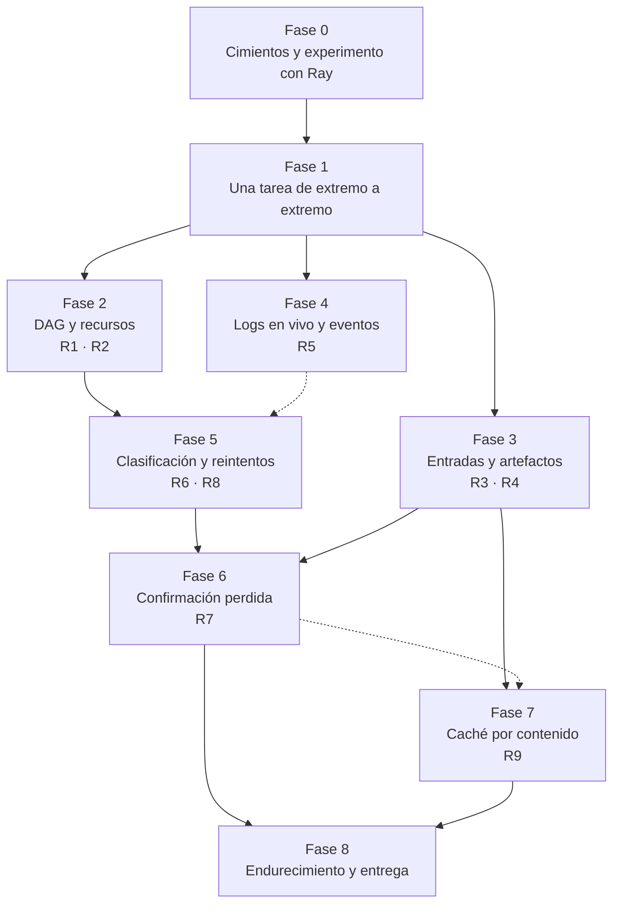

# 03 — Fases, cortes funcionales y dependencias

- **Fecha:** 2026-11-14
- **Estado:** aprobado el 2026-11-14
- **Paso:** planificación

Orden lógico de construcción. Los identificadores de features son los de
[01-analisis-de-features.md](01-analisis-de-features.md) y las decisiones `D02.k`
las de [02-arquitectura.md](02-arquitectura.md). Las fechas y el reparto están en
[04-plan-de-implementacion.md](04-plan-de-implementacion.md).

## 1. Decisiones de planificación

### D03.1 — Cortes verticales, no capas

- **Opciones:** (a) construir por capas: todo el coordinador, luego todo el
  ejecutor, luego el almacén, e integrar al final; (b) construir por cortes:
  cada fase añade una capacidad visible de extremo a extremo sobre un sistema
  que ya funciona.
- **Decisión:** (b). Cada fase termina en un **corte funcional**: una
  demostración que se ejecuta con un comando y que pasa o no pasa.
- **Porqué:** con (a) los problemas de integración aparecen en los últimos días,
  cuando ya no hay margen. Con (b), si el tiempo se acaba, lo construido hasta
  el último corte funciona y se puede entregar.

### D03.2 — La Fase 0 incluye un experimento sobre Ray

- **Decisión:** antes de escribir el clasificador se mide qué recibe el
  coordinador, y en cuánto tiempo, ante cada fallo provocado.
- **Porqué:** la taxonomía (D02.9) se apoya en lo que Ray deja ver. Es una
  suposición, y una suposición se convierte en experimento antes de construir
  sobre ella (Lab1). Si el resultado contradice D02.9, se corrige el diseño el
  día 2 y no el día 10.

### D03.3 — Contratos antes que implementaciones

- **Decisión:** los mensajes entre coordinador, ejecutor, almacén y registro de
  logs (intento, resultado, evidencia de fallo, fragmento de log) se fijan como
  tipos en la Fase 0 y se congelan al cerrar la Fase 1.
- **Porqué:** es lo que permite dos pistas en paralelo: cada persona programa
  contra el contrato y prueba con un doble del otro lado.
- **Consecuencia:** cambiar un contrato después de la Fase 1 requiere acuerdo de
  los dos y una decisión escrita.

### D03.4 — Cada corte se convierte en una prueba de extremo a extremo

- **Decisión:** el guion que demuestra un corte se añade a la integración
  continua al cerrar la fase.
- **Porqué:** un corte que no se vuelve a ejecutar se rompe sin que nadie lo
  note. Además, los guiones acumulados son la demostración final (T6).

### D03.5 — Orden: fallos, luego confirmación, luego caché

- **Decisión:** Fase 5 → Fase 6 en la pista de control; la Fase 7 va en
  paralelo en la otra pista.
- **Porqué:** la reconciliación (F7.4) se dispara desde el tratamiento de un
  fallo de infraestructura, así que necesita el clasificador. La caché comparte
  con la confirmación el guardado del resultado, pero su parte propia (la clave)
  solo necesita los digests de la Fase 3, de modo que puede avanzar a la vez.

## 2. Fases

### Fase 0 — Cimientos y experimento con Ray

- **Objetivo:** que exista un clúster de varios nodos, una integración continua
  y un conocimiento medido de cómo falla Ray.
- **Entra:** T1, T2 (unitarias y construcción de la imagen), T4 (andamiaje),
  contratos (D03.3), estructura del paquete (D02.16).
- **Corte C0:** un comando levanta el nodo de control y dos trabajadores y los
  tres figuran como vivos; la integración continua pasa; el documento de la fase
  contiene la tabla del experimento.
- **Experimento:** para cada situación, qué excepción recibe quien espera el
  resultado, cuánto tarda en recibirla y qué ocurre cuando el nodo vuelve.

  | Situación provocada | Se espera (D02.9) |
  |---------------------|-------------------|
  | El comando termina con error | Resultado normal con código ≠ 0 |
  | Se mata el proceso ejecutor | Aviso de proceso muerto |
  | Se mata el contenedor trabajador | Aviso de nodo muerto |
  | Se pausa el contenedor | Silencio; después, nodo declarado muerto |
  | Se desconecta de la red | Igual que el anterior |
  | Se reconecta tras ser declarado muerto | El nodo no retoma su trabajo anterior |

- **Depende de:** nada.

### Fase 1 — Una tarea de extremo a extremo

- **Objetivo:** el camino completo más corto: cliente → pasarela → coordinador →
  ejecutor → resultado → cliente.
- **Entra:** F1.1 (una sola tarea), F1.3, F1.4, F2.5 (estados mínimos), F3.1,
  F3.3, F3.4, F3.5, F5.1.
- **Corte C1:** se envía un trabajo de una tarea y `status` muestra `SUCCEEDED`
  con su salida; con un comando que falla muestra `FAILED` y el código; con uno
  que excede su tiempo límite, el árbol de procesos entero desaparece.
- **Se comprueba con:** unitarias del espacio aislado; integración sobre Ray
  local; primer guion de extremo a extremo.
- **Depende de:** Fase 0.

### Fase 2 — DAG y recursos

- **Objetivo:** cumplir R1 y R2 completos.
- **Entra:** F1.1 (completa), F1.2, F1.5, F2.1–F2.5; F2.6 (S).
- **Corte C2:** un trabajo en rombo (A → B y C → D) ejecuta B y C a la vez en
  trabajadores distintos, y el historial lo muestra; un trabajo con ciclo se
  rechaza nombrando el ciclo; si B falla, D queda `SKIPPED` y C termina; un
  recurso que ningún nodo tiene se rechaza al enviar; dos trabajos enviados a la
  vez terminan los dos.
- **Se comprueba con:** unitarias puras del grafo y de la máquina de estados
  (incluidas todas las transiciones inválidas).
- **Depende de:** Fase 1.

### Fase 3 — Entradas y artefactos

- **Objetivo:** cumplir R4 y cerrar R3.
- **Entra:** F4.1–F4.6, F3.2; F3.6 y F4.7 (S).
- **Corte C3:** en el proyecto de demostración, `compile` corre en un trabajador
  y `link` en otro usando el objeto producido; el cliente descarga el binario y
  su digest coincide; una tarea que intenta leer un fichero no declarado no lo
  encuentra.
- **Se comprueba con:** unitarias del almacén (escritura repetida, digest
  incorrecto rechazado, rutas con `..` rechazadas).
- **Depende de:** Fase 1.

### Fase 4 — Logs en vivo y eventos

- **Objetivo:** cumplir R5.
- **Entra:** F5.2–F5.5.
- **Corte C4:** `logs -f` muestra las líneas de una tarea larga mientras corre;
  tras matar su trabajador a mitad, lo emitido sigue consultable; `events`
  muestra el historial del trabajo con sus identificadores de ejecución.
- **Se comprueba con:** unitarias del registro (fragmento repetido ignorado,
  lectura por desplazamiento).
- **Depende de:** Fase 1.

### Fase 5 — Clasificación de fallos y reintentos

- **Objetivo:** cumplir R6 y R8.
- **Entra:** F6.1–F6.5, F8.1–F8.3; F8.4 (C). Incluye las herramientas de
  inyección de fallos (D02.15).
- **Corte C5:** cuatro guiones, cada uno con su evidencia en el historial:
  1. comando con error → clase `TASK`, sin reintento, trabajo `FAILED`;
  2. contenedor trabajador muerto a mitad → clase `WORKER`, relanzado en otro
     nodo, trabajo `SUCCEEDED`;
  3. corte durante una transferencia → clase `NETWORK`, esperas crecientes;
  4. presupuesto agotado → trabajo `ERROR`.
- **Se comprueba con:** unitarias puras del clasificador (una por fila de D02.9)
  y de la política (D02.11).
- **Depende de:** Fase 2 (máquina de estados). Débilmente de la Fase 4: el
  historial de eventos es donde se muestra la evidencia.

### Fase 6 — Confirmación perdida

- **Objetivo:** cumplir R7.
- **Entra:** F7.1–F7.6; F1.6 (S).
- **Corte C6:** con el punto de fallo «terminar justo después de guardar el
  resultado», el trabajo termina `SUCCEEDED`, el comando se ejecutó una sola vez
  y el historial registra «resultado adoptado por reconciliación»; una
  confirmación duplicada y una tardía no cambian nada; reenviar un trabajo con
  la misma clave de idempotencia devuelve el mismo identificador.
- **Se comprueba con:** pruebas de simulación sobre el núcleo puro (D02.3): se
  le entregan las confirmaciones en todos los órdenes relevantes (perdida,
  duplicada, tardía tras relanzar) y se comprueba S1 en cada uno.
- **Depende de:** Fase 5 (el fallo de infraestructura es lo que dispara la
  reconciliación) y Fase 3 (el resultado guardado contiene el manifiesto de
  artefactos).

### Fase 7 — Caché por contenido

- **Objetivo:** cumplir R9.
- **Entra:** F9.1–F9.4; F9.5 y F5.6 (S); F9.6 (C).
- **Corte C7:** reenviar el trabajo de demostración sin cambios no ejecuta
  ninguna tarea y los artefactos se descargan igual; cambiar un fichero fuente
  ejecuta solo su compilación y lo que depende de ella; un cambio que produce el
  mismo objeto (un comentario) recompila ese fichero pero no vuelve a enlazar.
- **Se comprueba con:** unitarias puras de la clave (qué la cambia y qué no,
  según D02.12).
- **Depende de:** Fase 3 (digests y manifiestos). Débilmente de la Fase 6: el
  índice de caché se escribe en el mismo guardado.

### Fase 8 — Endurecimiento y entrega

- **Objetivo:** que lo construido se pueda entregar y defender.
- **Entra:** T2 (completa, con los guiones de fallos), T3, T5, T6; F7.7 (S);
  F3.7 (C).
- **Corte C8:** desde un clon limpio, un comando levanta el clúster y ejecuta
  todos los guiones de C1 a C7; la imagen está publicada y la versión
  etiquetada; reiniciar el coordinador a mitad de un trabajo no impide que el
  trabajo termine (si F7.7 entra).
- **Depende de:** todas.

## 3. Mapa de dependencias

Flecha continua: no se puede empezar sin lo anterior. Flecha discontinua: se
puede empezar, pero la integración final lo necesita. La misma información como
imagen, con el reparto por persona y las fechas de cierre, está en
[05-diagramas.md](05-diagramas.md).

**Camino crítico:** 0 → 1 → 2 → 5 → 6 → 8. Un día de retraso en cualquiera de
estas fases es un día de retraso en la entrega.

**Pista paralela:** 3 → 4 → 7. Tiene holgura frente al camino crítico, salvo en
un punto: la Fase 6 necesita la Fase 3 terminada.

### Dependencias entre features

Las que cruzan de una fase a otra o de una pista a otra:

| Feature | Necesita | Porqué |
|---------|----------|--------|
| F2.2 despacho | F2.1, F2.5 | Las tareas listas se calculan sobre el grafo y los estados |
| F4.5 artefactos entre tareas | F4.4, F2.2 | Hace falta el manifiesto de la dependencia y saber que terminó |
| F5.2 logs incrementales | F3.1, F3.4 | Los emite el ejecutor mientras vigila al proceso |
| F6.2 clasificador | Experimento de la Fase 0, F6.5 | La evidencia es lo que Ray deja ver más los plazos propios |
| F8.1 reintentos | F6.2, F2.5 | Se decide por clase y se expresa como transición de estado |
| F7.2 guardado durable | F4.4 | El resultado incluye el manifiesto de salidas |
| F7.4 reconciliación | F6.2, F7.2, F7.3 | Se dispara por clase de fallo y consulta el guardado |
| F9.1 clave de acción | F4.1, F4.5 | Se calcula sobre digests, incluidos los de las dependencias |
| F9.2 consulta de caché | F9.1, F7.2 | El índice vive junto a los resultados guardados |
| F5.6 log en acierto de caché | F5.2, F9.2 | Sirve el log guardado de la ejecución original |
| F7.7 recuperación del coordinador | D02.4, F7.4 | Al arrancar, reconcilia lo que quedó en vuelo |

## 4. Trazabilidad de requisitos a fases

| Requisito | Fases | Corte que lo demuestra |
|-----------|-------|------------------------|
| R1 | 1, 2 (y 6 para F1.6) | C2 |
| R2 | 2 | C2 |
| R3 | 1, 3 | C1, C3 |
| R4 | 3 | C3 |
| R5 | 1, 4 | C4 |
| R6 | 5 | C5 |
| R7 | 6 (y 8 para F7.7) | C6 |
| R8 | 5 | C5 |
| R9 | 7 | C7 |

## 5. Línea de corte

### D03.6 — Qué se sacrifica si falta tiempo, y en qué orden

- **Decisión:** nunca un M. Se recorta en este orden:
  1. Los C: F3.7, F8.4, F9.6.
  2. Los S, del menos al más costoso de perder: F4.7, F5.6, F2.6, F9.5, F3.6,
     F1.6, F7.7.
- **Porqué de ese orden:** los primeros S son comodidades cuya ausencia no abre
  ninguna pregunta de corrección. F1.6 y F7.7 van al final porque son los que un
  tribunal echaría de menos: uno es la misma ambigüedad de R7 en la frontera del
  cliente, y el otro es lo que justifica haber guardado el estado en disco.
- **Cuándo se aplica:** en los dos puntos de control de 04 §3. Si un corte que
  debía estar cerrado no lo está, se recorta de las fases que quedan en ese
  mismo momento; no se espera al final.
