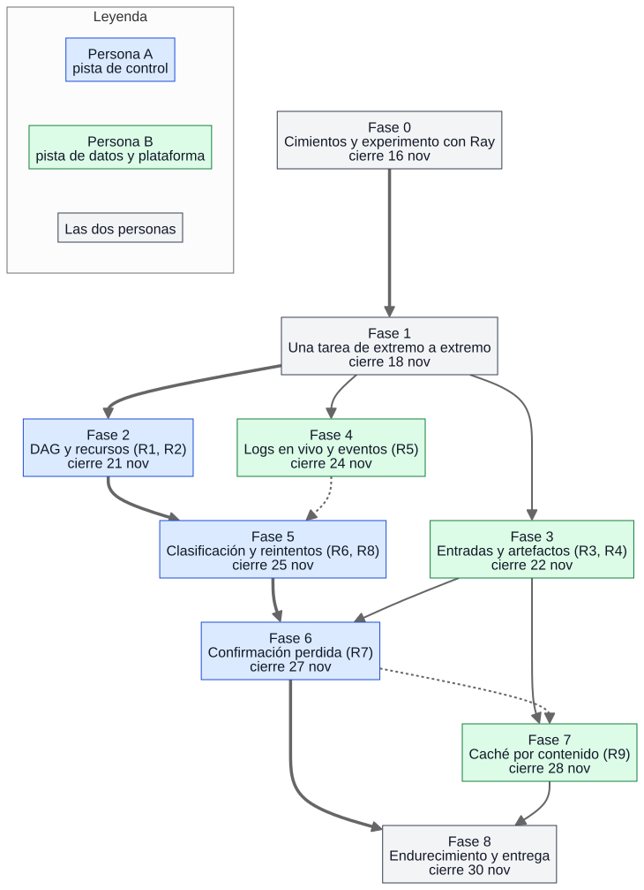
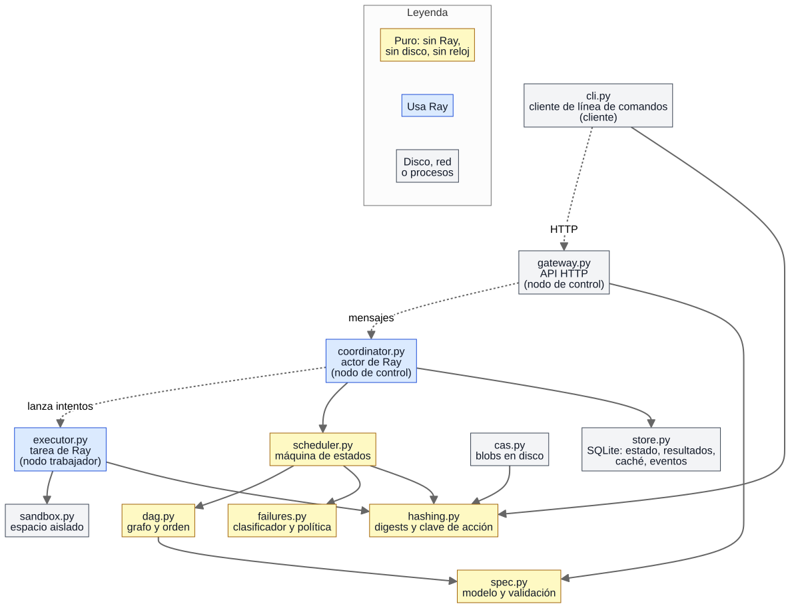
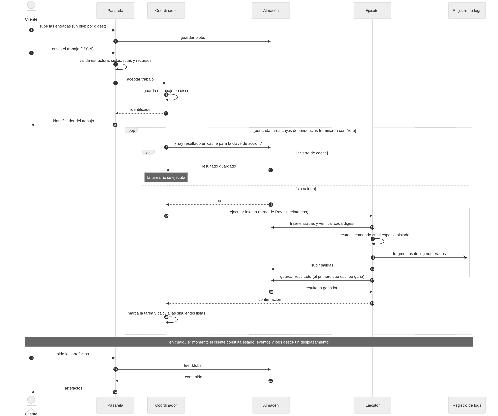
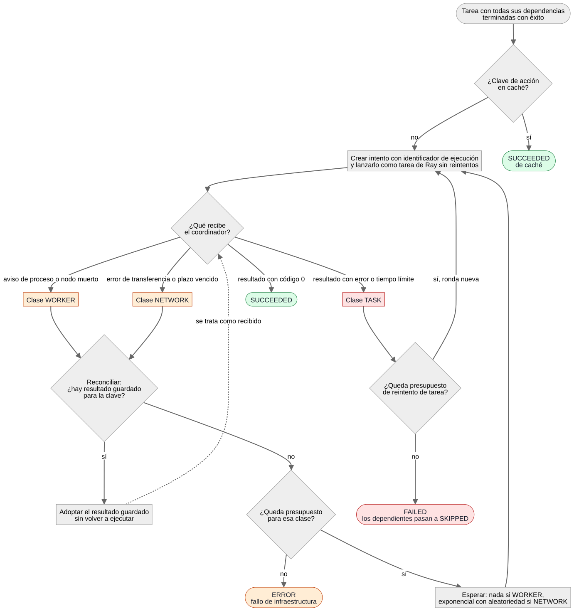
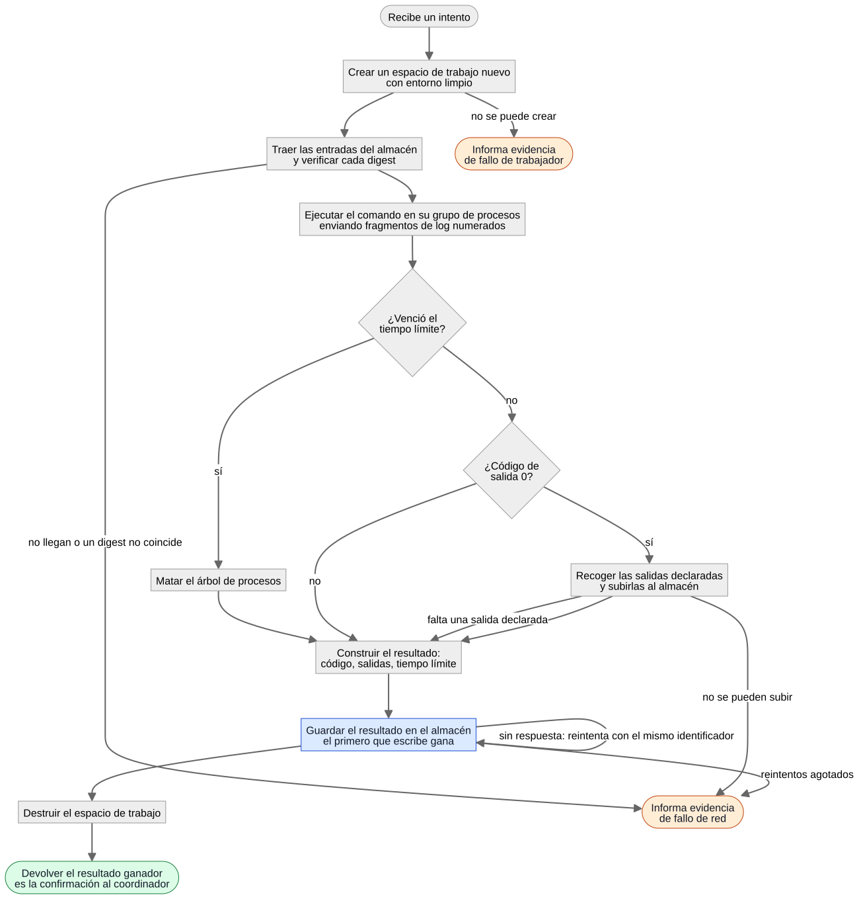
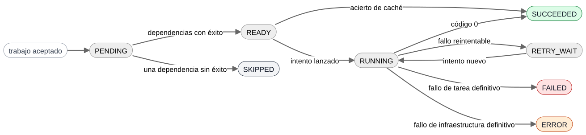
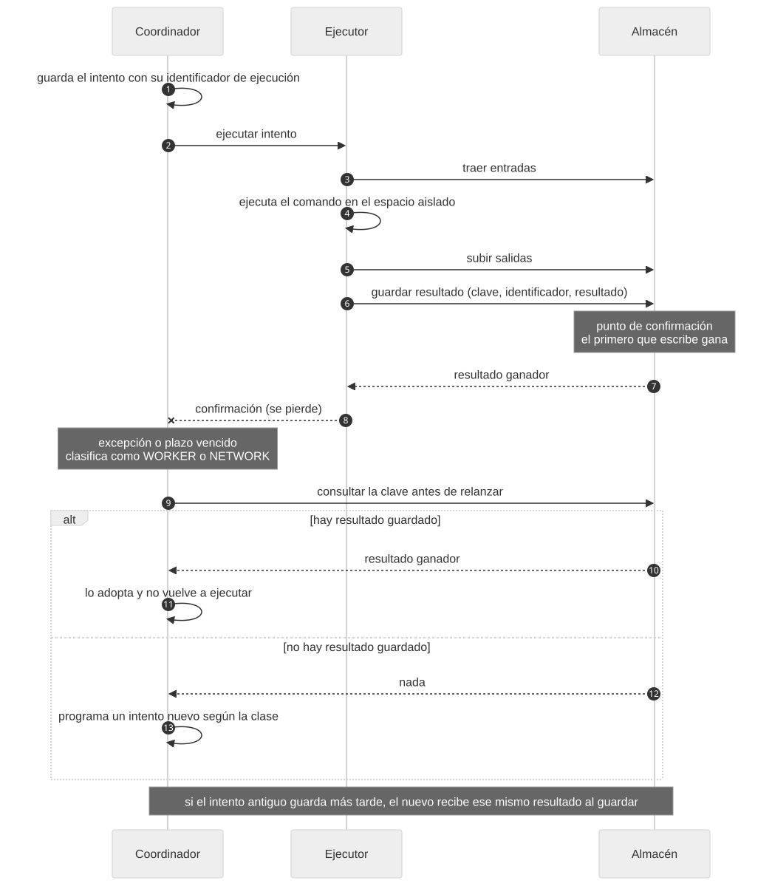

# 05 — Diagramas del sistema

- **Fecha:** 2026-11-14
- **Estado:** vigente; D05.3 pendiente de confirmar en la Fase 2
- **Paso:** representación visual del plan aprobado (01–04)

Cómo se construye el sistema y cómo debe funcionar una vez construido. Los
diagramas no añaden diseño: dibujan lo decidido en
[02-arquitectura.md](02-arquitectura.md) y
[03-fases-y-dependencias.md](03-fases-y-dependencias.md). Si un diagrama y esos
documentos se contradicen, mandan los documentos.

## 1. Decisiones

### D05.1 — Fuente en Mermaid e imagen SVG, las dos versionadas

- **Opciones:** (a) solo bloques Mermaid dentro del Markdown; (b) ficheros de
  una herramienta de dibujo; (c) fuente Mermaid en texto más su imagen SVG.
- **Decisión:** (c). Cada diagrama es un par `diagramas/<nombre>.mmd` (fuente) y
  `diagramas/<nombre>.svg` (imagen).
- **Porqué:** (a) solo se ve dibujado en GitHub; no sirve para el informe, las
  diapositivas ni un visor de Markdown cualquiera. (b) no se puede revisar en
  una solicitud de cambio ni comparar entre versiones. Con (c) la fuente se
  revisa como texto y la imagen se usa en cualquier sitio.
- **Consecuencia:** al cambiar una fuente hay que volver a generar su imagen.
  Las imágenes actuales se generaron con Mermaid 10.9.1, tema `neutral`,
  etiquetas como texto SVG (sin HTML incrustado) y fondo blanco. La herramienta
  de dibujo no es una dependencia del proyecto: no se instala ni se ejecuta con
  el sistema.

### D05.2 — Un diagrama por pregunta

- **Decisión:** siete diagramas, cada uno responde a una pregunta que alguien
  haría al leer el proyecto o al defenderlo (§2 y §3).
- **Porqué:** un diagrama único de «toda la arquitectura» no se lee. Separar por
  pregunta permite que cada uno quepa en una pantalla.

### D05.3 — Nombres de los estados de una tarea

> **Resuelta en la Fase 2 por D08.4:** `READY` no se adopta; el resto de
> nombres se mantiene. El diagrama de estados se regeneró el 2026-11-15.

- **Decisión (propuesta):** `PENDING`, `READY`, `RUNNING`, `RETRY_WAIT` y los
  finales `SUCCEEDED`, `FAILED`, `ERROR`, `SKIPPED`.
- **Porqué:** los cuatro finales ya estaban fijados (D01.4, D01.5). Los
  intermedios hacían falta para dibujar el ciclo de vida y siguen la separación
  de D02.3: `READY` es «puede arrancar», `RUNNING` es «hay un intento en vuelo»
  y `RETRY_WAIT` es «falló y hay presupuesto».
- **Estado:** se confirma o se corrige al implementar la máquina de estados
  (F2.5, Fase 2).

## 2. Dependencias

### ¿En qué orden se construye?

Flecha gruesa: camino crítico (0 → 1 → 2 → 5 → 6 → 8). Flecha fina: dependencia
dura fuera del camino crítico. Flecha discontinua: se puede empezar sin lo
anterior, pero la integración final lo necesita. El color indica quién lleva la
fase (D04.1, D04.7). Fuente de verdad: 03 §3.

### ¿Qué módulo usa a cuál?

Regenerado el 2026-11-15, al cerrar la Fase 1 y durante la Fase 2. Flecha
continua: un módulo importa a otro. Flecha de puntos entre módulos existentes:
se comunican por mensajes entre procesos. Recuadro y flecha discontinuos: módulo
previsto para una fase posterior.

Los cuatro módulos en amarillo no importan Ray ni tocan disco (D02.3), y nada
apunta desde ellos hacia fuera: por eso se pueden probar solos. Respecto a la
primera versión del diagrama cambiaron tres cosas: los contratos viven en
`messages.py` (D06.1); el ejecutor no conoce Ray, es el coordinador quien lo
convierte en tarea de Ray (D07.17); y `spec.py` usa `dag.py`, no al revés
(D08.7).

## 3. Flujos de la aplicación en funcionamiento

### ¿Qué pasa desde que envío un trabajo hasta que tengo los artefactos?

El camino sin fallos. El paso que cierra cada tarea es doble: el ejecutor guarda
el resultado en el almacén y después confirma al coordinador (D02.10).

### ¿Cómo decide el coordinador qué hacer con una tarea?

Es la lógica del núcleo puro (D02.3). Las tres clases de fallo salen de lo que
el coordinador recibe (D02.9). Las dos clases de infraestructura pasan por la
reconciliación antes de relanzar (D02.10), y cada clase tiene su presupuesto y
su espera (D02.11). Un resultado adoptado se trata igual que uno recibido:
puede ser un éxito o un fallo de tarea.

### ¿Qué hace un trabajador con un intento?

El recuadro azul es el punto de confirmación. El espacio de trabajo se destruye
siempre, también en las salidas por fallo, que el diagrama no repite para no
recargarlo.

### ¿Por qué estados pasa una tarea?

Ver D05.3 y D08.4. Las transiciones discontinuas llegan en fases posteriores:
los reintentos en la Fase 5 y la caché en la Fase 7. «Código 0» incluirá el
resultado adoptado por reconciliación (Fase 6).

### ¿Qué pasa si la tarea terminó pero la confirmación se perdió?

El caso R7 completo (D02.10): lo que se pierde es el mensaje, no el resultado.
