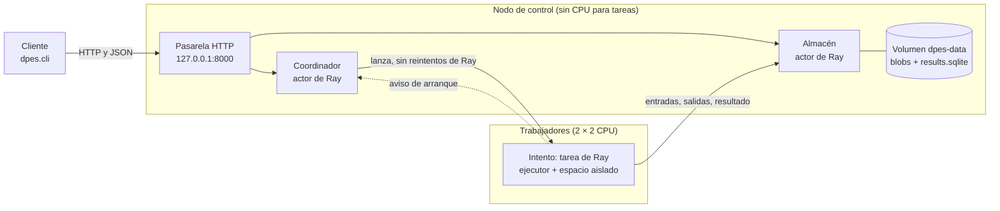

# 13 — Informe técnico del estado del proyecto

- **Fecha:** 2026-11-16
- **Corte del informe:** commit `dd605e8` de `main`; CI en verde (ejecución
  43807905690)
- **Redacta:** persona A (Juan Carlos)
- **Propósito:** dejar por escrito qué está construido, con qué garantías y con
  qué evidencia, qué se desvió del plan aprobado, qué límites tiene hoy el
  sistema y qué falta hasta la entrega del 1 de diciembre de 2026.

Todos los datos de este informe se comprobaron en el repositorio y en la CI el
día de su redacción. Las referencias `Dxx.k` remiten a las decisiones de los
documentos `plan/xx`.

## 1. Resumen

- **6 de las 9 fases cerradas** (0, 1, 2, 3, 5 y 6), cada una con su corte
  funcional pasando en la CI de GitHub. Faltan la 4 (logs de las tareas), la 7
  (caché) y la 8 (entrega).
- **7 de los 9 requisitos de la orientación cumplidos** con evidencia
  automatizada: R1, R2, R3, R4, R6, R7 y R8. Faltan **R5** (registro y
  transmisión de logs de las tareas) y **R9** (caché por contenido).
- **Adelanto sobre el calendario:** las seis fases cerradas tenían fecha entre
  el 16 y el 27 de noviembre; se cerraron el 15 y el 16. El primer punto de
  control (22 nov: C0–C3) ya se cumple; del segundo (26 nov: C4 y C5) falta C4.
- **Código:** 1786 líneas de Python en 15 módulos, con Ray como única
  dependencia externa (`ray==2.60.0`). **Pruebas:** 243, en cuatro niveles.
- **Lo pendiente se concentra en la pista B** (Fases 4 y 7) y en la entrega
  (Fase 8), que incluye la entrega continua (publicación de la imagen), aún no
  hecha.

## 2. Estado frente a la orientación

| Req. | Qué pide | Estado | Mecanismo | Evidencia (corte · CI) |
|------|----------|--------|-----------|------------------------|
| R1 | Recepción de trabajos con dependencias | ✅ | Trabajo JSON validado entero en la frontera, con todos los errores a la vez (D07.1, D07.2, D08.1); envío idempotente (D12.7) | C2 · 43736551521 |
| R2 | Planificación de un DAG de tareas | ✅ | Ciclos rechazados nombrando el camino (D08.2); despacho por tareas listas y omisión de dependientes (D08.4, D08.5); ubicación por recursos (D08.3) | C2 · 43736551521 |
| R3 | Ejecución aislada en trabajadores | ✅ | Espacio de trabajo nuevo, entorno limpio, grupo de procesos matado entero, usuario sin privilegios por intento (D07.15, D07.16); solo entra y sale lo declarado (D11.6) | C1 · 43732301774; C3 · 43791223473 |
| R4 | Transferencia de entradas y artefactos | ✅ | Almacén por contenido SHA-256 en el nodo de control; digest verificado en cada salto; artefactos de las dependencias colocados solos (D11.3–D11.5) | C3 · 43791223473 |
| R5 | Registro y transmisión de logs | 🟡 | Hoy: cola de 64 KiB de la salida en el resultado (D07.14) y logs operativos del sistema (plan/10). Falta la transmisión en vivo (Fase 4) | — |
| R6 | Clasificación de fallos de tarea, trabajador y red | ✅ | Clasificador puro de lo observado a `TASK`/`WORKER`/`NETWORK` (D09.1), con la evidencia en el historial de intentos (D09.6) | C5 · 43740571857 |
| R7 | «La tarea terminó, pero se perdió la confirmación» | ✅ | Guardado antes de contestar, el primero que escribe gana, reconciliación antes de reintentar (D12.1–D12.5) | C6 · 43807400756 |
| R8 | Reintentos según el tipo de fallo | ✅ | Presupuesto por clase y por tarea; espera exponencial con aleatoriedad para `NETWORK`; plazo de cola y de ejecución por intento (D09.2–D09.4) | C5 · 43740571857 |
| R9 | Caché por contenido | ⬜ | Fase 7 | — |

## 3. Arquitectura construida



Ray aporta el clúster, la colocación por recursos y el transporte; el orden,
la clasificación, los reintentos, la confirmación y (en la Fase 7) la caché
son código propio (D02.1). Cada intento es una tarea de Ray con
`max_retries=0`, para que Ray no reintente a espaldas del coordinador.

| Módulo | Líneas | Papel | Puro | Pista |
|--------|-------:|-------|:----:|:-----:|
| `messages.py` | 87 | Contratos entre componentes (congelados en la Fase 1) | ✔ | A |
| `spec.py` | 273 | Formato del trabajo, validación, recursos | ✔ | A |
| `dag.py` | 35 | Detección de ciclos iterativa | ✔ | A |
| `failures.py` | 54 | Clasificador y esperas de reintento | ✔ | A |
| `scheduler.py` | 239 | Máquina de estados de un trabajo | ✔ | A |
| `hashing.py` | 15 | Digests SHA-256 | ✔ | B |
| `coordinator.py` | 359 | Actores coordinador y almacén, plazos, reconciliación | | A |
| `gateway.py` | 152 | API HTTP y frontera de confianza | | A |
| `cli.py` | 153 | Cliente: `submit`, `status`, `wait`, `artifacts` | | A |
| `executor.py` | 166 | Un intento: entradas, comando, salidas, confirmación | | B |
| `sandbox.py` | 79 | Espacio aislado del comando | | B |
| `cas.py` | 52 | Blobs en disco, escritura atómica | | B |
| `store.py` | 60 | Resultados confirmados en SQLite | | A |
| `log.py` | 56 | Formato y configuración de los logs | | A |

Los seis módulos puros no importan Ray ni tocan disco ni reloj (D02.3): se
prueban en Windows, sin clúster. La API HTTP: `POST /jobs` (con
`Idempotency-Key` opcional), `GET /jobs/{id}`, `PUT` y `GET /blobs/{digest}`.

## 4. Recorrido de un trabajo, tal como funciona hoy

1. El cliente sube las entradas por digest y envía el trabajo con una clave de
   idempotencia; si no llega a la pasarela, reintenta con la misma clave.
2. La pasarela valida estructura, dependencias, ciclos y rutas; el adaptador
   rechaza lo que ningún nodo vivo podría ejecutar o lo que referencia blobs no
   subidos. Todo rechazo es un `400` con todos los errores.
3. El coordinador crea el trabajo y lanza las tareas sin dependencias, cada una
   con sus recursos traducidos a Ray.
4. En el trabajador, el envoltorio avisa del arranque (empieza el plazo de
   ejecución), el ejecutor coloca y verifica las entradas, ejecuta el comando
   en el espacio aislado, sube las salidas declaradas y **guarda el resultado
   antes de contestar**. Devuelve el resultado ganador.
5. El coordinador recibe el resultado o un fallo. Ante un fallo sin resultado
   consulta antes el almacén y, si el resultado estaba guardado, lo adopta.
   Si no, clasifica y reintenta dentro del presupuesto de esa clase o da la
   tarea por terminada, omitiendo sus dependientes.
6. El trabajo termina `SUCCEEDED`, `FAILED` (la tarea falló por sí misma) o
   `ERROR` (la infraestructura falló); `wait` sale con 0, 1 o 2. El cliente
   descarga los artefactos verificando su digest.

## 5. Modelo de fallos y garantías

| Fallo | Cómo se detecta | Qué se hace | Prueba |
|-------|-----------------|-------------|--------|
| El comando falla o excede su tiempo | Resultado con código ≠ 0 o `timed_out` | `TASK`: sin reintento por defecto; ronda nueva si se declara | `test_failures` (e2e) |
| Muere el proceso del ejecutor | `WorkerCrashedError` | Reconciliar; si no hay resultado, `WORKER`: reintento inmediato | `test_failures` (e2e) |
| Muere el contenedor trabajador | `NodeDiedError` (0,2 s en el experimento) | Igual; el reintento va a otro trabajador | `tests/host/test_worker_loss.py` |
| Trabajador pausado o incomunicado | Solo el plazo propio: Ray no avisa (D06.14) | Cancelar, reconciliar, `NETWORK` con espera creciente | `test_failures` (e2e, `hang`) |
| Fallo de transferencia o digest distinto | `ExecutorFailure` del ejecutor | Reconciliar, `NETWORK` | `test_executor`, `test_failures` |
| Se guarda el resultado y se pierde la respuesta | Fallo sin resultado + resultado en el almacén | Se adopta; el comando no se repite | `test_lost_ack` (e2e) |
| La respuesta al envío se pierde | El cliente no recibe nada | Reenvío con la misma clave: mismo trabajo | `test_lost_ack`, `test_gateway` |

| Garantía (02 §1) | Estado | Cómo se sostiene |
|------------------|--------|------------------|
| S1: un resultado confirmado por tarea y ronda | ✅ | Clave primaria de SQLite; dos escritores sobre el mismo fichero acuerdan un ganador (`test_store`) |
| S2: no se arranca sin dependencias con éxito | ✅ | Máquina de estados (`test_scheduler`) |
| S3: el contenido entregado coincide con su digest | ✅ | Verificación en cada salto (D11.4) |
| S4: la caché solo reutiliza acciones idénticas | ⬜ | Fase 7 |
| L1: todo trabajo aceptado termina | ✅ con una excepción | Plazos por intento y presupuestos finitos. **Excepción:** si el coordinador se reinicia, sus trabajos se pierden (D07.8) |

Semántica de ejecución (D12.8): el **comando** se ejecuta *al menos una vez*
(se repite si el ejecutor muere antes de guardar); el **resultado** se
confirma *como mucho una vez* por ronda, y el cliente ve uno solo.

## 6. Verificación

| Nivel | Pruebas | Dónde corren |
|-------|--------:|--------------|
| Unitarias | 197 | Windows (159; las del espacio aislado y el ejecutor necesitan Linux), contenedor como `root` y sin privilegios, CI |
| Integración | 17 | Clúster, actor real con un ejecutor de prueba |
| Extremo a extremo | 22 | Clúster, por la pasarela: cortes C0, C1, C2, C3, C5 y C6 |
| Desde el anfitrión | 7 | Docker: caída real de un trabajador y traza de logs de un trabajo |
| **Total** | **243** | |

Cada push a `main` ejecuta la CI de `.github/workflows/ci.yml`: unitarias fuera
del contenedor y, sobre el clúster de tres nodos, el resto de niveles. Las
pruebas encontraron errores reales antes de la entrega, entre ellos: una
excepción perdida que dejaba trabajos en `RUNNING` para siempre (D07.12), una
garantía de crecimiento de las esperas que solo valía hasta el tope (D09.3),
un plazo vencido confundido con lo que devolvía el ejecutor (D09.10), el logger
de la pasarela descartado al arrancar con `python -m` (D10.8) y una carrera al
leer `/proc` que hacía intermitente una prueba (plan/07, §3).

## 7. Desviaciones respecto al plan aprobado

| Qué | Decisión | Efecto |
|-----|----------|--------|
| Estado del coordinador en memoria hasta la Fase 8 | D07.8 | Un reinicio del coordinador pierde los trabajos en curso y las claves de idempotencia |
| Sin estado `READY` | D08.4 | `RUNNING` incluye la espera en la cola de Ray |
| Límite de intentos en vuelo (F2.6) aplazado | D08.6 | Lo amortigua la cola de Ray |
| No se evita el nodo sospechoso (F8.4) | D09.9 | Un reintento puede caer en un trabajador incomunicado |
| Subida incremental (F4.7) y límites del SO (F3.6) | D11.9 | Se sube cada entrada entera; sin límites de memoria ni procesos por tarea |
| Fase 5 antes que la 3 y la 4 | plan/09 | Sin efecto: solo dependía de la 2 |
| Sin ramas ni solicitudes de cambio | D04.8 | La revisión se hace antes de subir |
| Sistema de logs operativos, fuera de las fases | plan/10 | Pedido aparte; cada línea lleva `job=` o `execution=` |
| La persona A hizo partes de la pista B | plan/06, plan/07, plan/12 | Fases 0 y 1 de B, y el ejecutor y el almacén en la 6 |

## 8. Límites conocidos y deuda técnica

- **Punto único de fallo:** el nodo de control (pasarela, coordinador y
  almacén) no está replicado; se promete durabilidad de lo guardado, no
  disponibilidad (D02.4).
- **Aislamiento incompleto:** una tarea puede leer el sistema de ficheros del
  trabajador, escribir en `/tmp`, usar la red y escapar del grupo con `setsid`
  (D07.15, D07.16); un intento matado deja su espacio de trabajo (D11.11).
- **Sin autenticación:** la pasarela solo escucha en `127.0.0.1` (D07.18) y la
  inyección de fallos está activada en el clúster de pruebas (D09.7).
- **Tamaños:** cuerpo de petición hasta 1 MiB; cada blob viaja entero en
  memoria, hasta 16 MiB (D11.5).
- **Logs:** las líneas del coordinador se reúnen en el proceso de la pasarela;
  si esta se reinicia sin el clúster, dejan de verse en `docker logs` (D10.7).
- **Alcance de los experimentos:** tres contenedores en una máquina no son tres
  máquinas; la detección rápida de un contenedor muerto no vale para un corte
  de corriente (D06.13).
- **Diagramas desactualizados:** el de módulos (plan/05) muestra como
  «previstos» `store`, `cas`, `failures` y `hashing`, que ya existen, y no
  incluye `log.py`. Se regeneran en la Fase 8.

## 9. Lo que falta hasta la entrega

| Fase | Contenido | Quién | Fecha del plan | Depende de |
|------|-----------|:-----:|:--------------:|------------|
| 4 · Logs | Envío incremental de la salida, consulta en vivo (`logs -f`), logs que sobreviven al trabajador, historial de eventos (F5.2–F5.5) | B | 24 nov | Nada pendiente |
| 7 · Caché | Clave de acción, consulta antes de despachar, solo éxitos, claves encadenadas (F9.1–F9.4) | B | 28 nov | Nada pendiente; usará los resultados de `store.py` |
| 8 · Entrega | Publicación de la imagen (T3), comparación con GitHub Actions, Buildkite y HTCondor (T5), demostración desde un clon limpio (T6), recuperación del coordinador (F7.7, S), diagramas al día | A y B | 30 nov | Fases 4 y 7 para la demostración completa |

**Riesgo principal:** todo lo que falta de los requisitos (R5 y R9) depende de
la pista B, mientras la pista A ya no tiene fases propias bloqueadas por nada.

**Recomendación:** la persona A puede adelantar ya las partes de la Fase 8 que
no dependen de las Fases 4 y 7: la publicación de la imagen (es la mitad de
CI/CD que falta), la comparación arquitectónica y la recuperación del
coordinador (F7.7), que cerraría la excepción de L1 y el principal punto débil
frente a un tribunal.

## 10. Cómo reproducir este estado

Con Docker Desktop en marcha, desde la raíz del repositorio:

```
docker compose -f docker/compose.yaml up -d --build
py -m unittest discover -s tests/unit
docker compose -f docker/compose.yaml exec -T head python -m unittest discover -s tests/integration
docker compose -f docker/compose.yaml exec -T head python -m unittest discover -s tests/e2e
py -m unittest discover -s tests/host
py -m dpes.cli submit examples/hola/job.json
```
